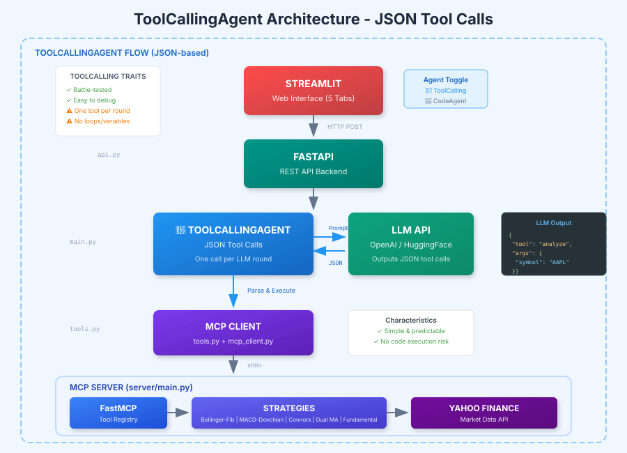
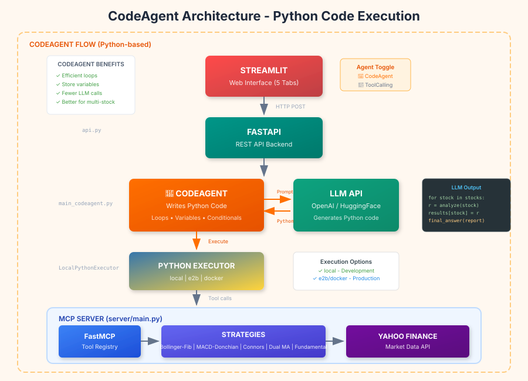

# 📊 MCP Financial Markets Analysis Tool

An AI-powered financial analysis platform that combines **Model Context Protocol (MCP)**, **smolagents**, **FastAPI**, and **Streamlit** to deliver professional-grade investment analysis reports. The system uses Large Language Models to orchestrate trading strategy tools and interpret financial data, transforming raw market data into actionable investment insights.

<p align="center">
  
  
  
  
  
</p>

---

## 🎯 Overview

This application provides **7 distinct analysis types** through a modern web interface:

| Analysis Type | Description | Use Case |
|--------------|-------------|----------|
| **📈 Technical Analysis** | 4 trading strategies on single stock | Deep dive into price patterns |
| **🔍 Market Scanner** | Compare multiple stocks simultaneously | Find best opportunities |
| **💰 Fundamental Analysis** | Financial statements interpretation | Assess company health |
| **🌐 Multi-Sector Analysis** | Cross-sector comparison | Portfolio diversification |
| **🔄 Combined Analysis** | Technical + Fundamental together | Complete investment thesis |
| **🌙 Overnight Gaps** | Prior close vs next open gaps, fill rates, same-day drift | Gap/midnight return behavior |
| **⚡ Earnings Momentum** | Volume-spike momentum scan with fixed hold window | Post-earnings breakout hunting |

### What Makes This Different?

Unlike traditional analysis tools that just display numbers, this system uses **AI to interpret** the data:

```
Traditional Tool: "RSI = 28.5, MACD = -2.3, P/E = 15.2"

This Application: "AAPL shows oversold conditions with RSI at 28.5, suggesting 
                   a potential mean reversion opportunity. Combined with strong 
                   fundamentals (P/E of 15.2 below sector average), this presents 
                   a BUY signal with high conviction..."
```

---

## 🤖 Two Agent Architectures

This application supports **two different AI agent types**, each with distinct advantages:

### 🔧 ToolCallingAgent (Original)

The traditional approach where the LLM outputs JSON to call tools one at a time.

<p align="center">
  
</p>

### 🐍 CodeAgent (New - Recommended)

The advanced approach where the LLM writes Python code to call tools, enabling loops and variables.

<p align="center">
  
</p>

---

## ⚖️ Agent Comparison: ToolCallingAgent vs CodeAgent

### How They Work

| Aspect | 🔧 ToolCallingAgent | 🐍 CodeAgent |
|--------|---------------------|--------------|
| **Output Format** | JSON tool calls | Python code |
| **Tool Invocation** | `{"tool": "analyze", "args": {...}}` | `result = analyze(symbol="AAPL")` |
| **Multi-tool** | One call per LLM round | Can batch with loops |
| **Variables** | ❌ Cannot store results | ✅ Can use variables |
| **Loops** | ❌ Not supported | ✅ `for stock in stocks:` |
| **Conditionals** | ❌ Not supported | ✅ `if signal == "BUY":` |

### Example: Analyzing 5 Stocks

**ToolCallingAgent Approach:**
```
Round 1: LLM → "Call analyze(AAPL)" → Result
Round 2: LLM → "Call analyze(MSFT)" → Result  
Round 3: LLM → "Call analyze(GOOGL)" → Result
Round 4: LLM → "Call analyze(META)" → Result
Round 5: LLM → "Call analyze(NVDA)" → Result
Round 6: LLM → Synthesize all results → Report

Total: 6 LLM calls
```

**CodeAgent Approach:**
```python
# LLM generates this code in ONE round:
results = {}
for stock in ["AAPL", "MSFT", "GOOGL", "META", "NVDA"]:
    results[stock] = analyze(symbol=stock, period="1y")

# Calculate consensus
buy_signals = sum(1 for r in results.values() if "BUY" in r)
report = f"Consensus: {buy_signals}/5 stocks show BUY signals..."

final_answer(report)

Total: 1-2 LLM calls
```

### Performance Comparison

| Scenario | ToolCallingAgent | CodeAgent | Improvement |
|----------|-----------------|-----------|-------------|
| 1 stock, 4 tools | ~45 seconds | ~40 seconds | ~10% faster |
| 5 stocks, 4 tools each | ~3 minutes | ~1.5 minutes | ~50% faster |
| 3 sectors, 30 stocks | ~15 minutes | ~5 minutes | ~66% faster |

### Pros and Cons

#### 🔧 ToolCallingAgent

| ✅ Pros | ❌ Cons |
|---------|---------|
| Simple and predictable | One tool call per LLM round |
| No code execution risks | More LLM API calls = higher cost |
| Easier to debug | Slower for multi-stock analysis |
| Works with any LLM | Cannot compose complex logic |
| Battle-tested approach | Limited to sequential execution |

**Best For:**
- Single stock analysis
- Simple queries
- Production environments with strict security
- LLMs with weaker code generation

#### 🐍 CodeAgent

| ✅ Pros | ❌ Cons |
|---------|---------|
| Efficient loops for multi-stock | Requires code execution sandbox |
| Fewer LLM calls = lower cost | More complex to debug |
| Can store and reuse results | Needs LLM with good Python skills |
| Natural code-based reasoning | Security considerations |
| Better for complex analysis | May generate invalid code |

**Best For:**
- Multi-stock scanning
- Multi-sector analysis
- Complex comparative analysis
- Development environments
- Cost-conscious usage

### Security Considerations

| Executor | Security Level | Use Case |
|----------|---------------|----------|
| `local` | ⚠️ Low | Development only |
| `e2b` | ✅ High | Production (cloud sandbox) |
| `docker` | ✅ High | Production (self-hosted) |

```python
# Development (local execution)
agent = CodeAgent(tools=tools, model=model, executor_type="local")

# Production (E2B sandbox)
agent = CodeAgent(tools=tools, model=model, executor_type="e2b")

# Production (Docker sandbox)
agent = CodeAgent(tools=tools, model=model, executor_type="docker")
```

### When to Use Which

```
┌─────────────────────────────────────────────────────────────────┐
│                    DECISION FLOWCHART                           │
├─────────────────────────────────────────────────────────────────┤
│                                                                 │
│  Analyzing single stock?                                        │
│      │                                                          │
│      ├── YES → Either agent works fine                          │
│      │                                                          │
│      └── NO (multiple stocks)                                   │
│              │                                                  │
│              └── Use CodeAgent (2-3x faster)                    │
│                                                                 │
│  Production environment?                                        │
│      │                                                          │
│      ├── YES + Security critical → ToolCallingAgent             │
│      │                                                          │
│      ├── YES + Performance critical → CodeAgent + e2b/docker    │
│      │                                                          │
│      └── NO (development) → CodeAgent + local                   │
│                                                                 │
│  LLM has weak Python skills?                                    │
│      │                                                          │
│      └── YES → ToolCallingAgent (more reliable)                 │
│                                                                 │
└─────────────────────────────────────────────────────────────────┘
```

---

## 🏗️ Architecture Overview

### Folder Structure

```
mcp_financial_markets_analysis_tool/
│
├── server/                          # MCP Server (Financial Tools)
│   ├── main.py                      # Server entry point
│   ├── strategies/                  # Trading strategy implementations
│   │   ├── bollinger_fibonacci.py   # Bollinger + Fibonacci
│   │   ├── macd_donchian.py         # MACD + Donchian Channel
│   │   ├── connors_zscore.py        # Connors RSI + Z-Score
│   │   ├── dual_moving_average.py   # 50/200 EMA Crossover
│   │   ├── bollinger_zscore.py      # Bollinger + Z-Score
│   │   ├── fundamental_analysis.py  # Financial Statements (70+ row aliases)
│   │   ├── performance_tools.py     # Backtesting Tools
│   │   └── unified_market_scanner.py# Multi-Stock Scanner
│   ├── utils/
│   │   └── yahoo_finance_tools.py   # Data & Indicator Calculations
│   └── README.md                    # 📚 Detailed Server Documentation
│
├── stock_analyzer_bot/              # Smolagents Bot (AI Orchestration)
│   ├── __init__.py
│   ├── main.py                      # ToolCallingAgent implementation
│   ├── main_codeagent.py            # CodeAgent implementation (NEW)
│   ├── api.py                       # FastAPI REST endpoints
│   ├── tools.py                     # Smolagents tool wrappers
│   ├── mcp_client.py                # MCP connection manager
│   └── README.md                    # 📚 Detailed Bot Documentation
│
├── docs/
│   ├── architecture.svg             # ToolCallingAgent diagram
│   ├── architecture_codeagent.svg   # CodeAgent diagram (NEW)
│   └── Sectors_reference.md         # Sector symbols reference
│
├── streamlit_app.py                 # Web UI (7 Analysis Tabs)
├── .env                             # Environment variables
├── requirements.txt                 # Python dependencies
└── README.md                        # 📚 This file
```

### Data Flow Summary

Both agent types follow the same high-level flow:

1. **Streamlit** → User interacts with web interface
2. **FastAPI** → REST API receives requests, selects agent type
3. **Agent** → ToolCallingAgent OR CodeAgent processes request
4. **LLM API** → OpenAI/HuggingFace guides tool selection
5. **MCP Client** → Bridges agent to MCP server
6. **MCP Server** → Executes financial analysis tools
7. **Strategies** → Calculate technical indicators
8. **Yahoo Finance** → Provides market data

---

## 🤖 Understanding Smolagents

### What is Smolagents?

[**Smolagents**](https://huggingface.co/docs/smolagents/index) is an open-source Python library from Hugging Face that makes it easy to build AI agents that can use tools.

> *"smolagents is designed to make it extremely easy to build and run agents using just a few lines of code."* - HuggingFace

### Why CodeAgent is Recommended

According to [HuggingFace research](https://huggingface.co/docs/smolagents/tutorials/secure_code_execution):

> *"Multiple research papers have shown that having the LLM write its actions in code is much better than the current standard format for tool calling, which is different shades of writing actions as a JSON."*

**Code is better because:**
- **Composability**: Nest functions, use loops, create reusable logic
- **Object Management**: Store outputs in variables for later use
- **Generality**: Express any computation, not just tool calls
- **Training Data**: LLMs have seen lots of Python code in training

---

## 📱 Streamlit Interface

### Agent Selection Toggle

The sidebar now includes an agent type selector:

```
┌─────────────────────────────────────┐
│  ⚙️ Settings                        │
│                                     │
│  🤖 Agent Type                      │
│  ○ 🔧 ToolCallingAgent (Original)   │
│  ● 🐍 CodeAgent (New - Faster)      │
│                                     │
│  Code Executor: [local ▼]           │
│                                     │
└─────────────────────────────────────┘
```

### 7 Analysis Types

| Tab | Description | Recommended Agent |
|-----|-------------|-------------------|
| 📈 Technical | Single stock, 4 strategies | Either |
| 🔍 Scanner | Multi-stock comparison (5 strategies) | 🐍 CodeAgent |
| 💰 Fundamental | Financial statements | Either |
| 🌐 Multi-Sector | Cross-sector analysis | 🐍 CodeAgent |
| 🔄 Combined | Tech + Fundamental | Either |
| 🌙 Overnight Gaps | Gap/midnight returns + fill rates | Deterministic or 🐍 CodeAgent summary |
| ⚡ Earnings Momentum | Volume spikes + bullish follow-through | 🔧 ToolCalling or 🐍 CodeAgent |

---

## 🚀 Quick Start

### Prerequisites

- Python 3.10+
- OpenAI API key (recommended) or HuggingFace token
- Internet connection (Yahoo Finance data)

### Installation

```bash
# Clone the repository
git clone <repository-url>
cd mcp_financial_markets_analysis_tool

# Create virtual environment
python -m venv venv
source venv/bin/activate  # Linux/Mac
# or
.\venv\Scripts\activate   # Windows

# Install dependencies
pip install -r requirements.txt
```

### Environment Setup

Create a `.env` file in the project root:

```bash
# Required - LLM API Key (choose one)
OPENAI_API_KEY=sk-your-openai-key-here
# OR
HF_TOKEN=hf_your-huggingface-token

# Model Configuration
SMOLAGENT_MODEL_ID=gpt-4o           # Recommended for CodeAgent
SMOLAGENT_MODEL_PROVIDER=litellm     # litellm or inference

# Agent Configuration
SMOLAGENT_AGENT_TYPE=code_agent      # tool_calling or code_agent
SMOLAGENT_EXECUTOR=local             # local, e2b, or docker
SMOLAGENT_MAX_STEPS=25               # Max reasoning steps
SMOLAGENT_TEMPERATURE=0.1            # Low for deterministic outputs
SMOLAGENT_MAX_TOKENS=8192            # Prevents output truncation

# Optional - Defaults
DEFAULT_ANALYSIS_PERIOD=1y
DEFAULT_SCANNER_SYMBOLS=AAPL,MSFT,GOOGL,AMZN
```

### Running the Application

```bash
# Terminal 1: Start the FastAPI backend
uvicorn stock_analyzer_bot.api:app --reload --port 8000

# Terminal 2: Start the Streamlit frontend
streamlit run streamlit_app.py
```

Open your browser to `http://localhost:8501`

---

## 🔧 Core Components

### 1. MCP Server (`server/`)

The **Model Context Protocol Server** provides all financial analysis tools.

**Key Features:**
- 5 technical analysis strategies
- Performance backtesting with metrics
- Fundamental analysis with 70+ row aliases for robust yfinance data extraction
- Multi-stock unified market scanner

📚 **Detailed Documentation:** [server/README.md](server/README.md)

### 2. Stock Analyzer Bot (`stock_analyzer_bot/`)

The **smolagents-powered orchestration layer** with dual agent support.

**Key Files:**
- `main.py` - ToolCallingAgent implementation (HIGH-LEVEL tools)
- `main_codeagent.py` - CodeAgent implementation (LOW-LEVEL tools)
- `api.py` - FastAPI endpoints with agent selection
- `tools.py` - MCP tool wrappers

📚 **Detailed Documentation:** [stock_analyzer_bot/README.md](stock_analyzer_bot/README.md)

### 3. Streamlit Frontend (`streamlit_app.py`)

The **web interface** with agent toggle and 7 analysis tabs.

---

## 📡 API Reference

### Agent Selection

All endpoints now accept `agent_type` parameter:

```json
{
  "symbol": "AAPL",
  "period": "1y",
  "agent_type": "code_agent",
  "executor_type": "local"
}
```

### Available Endpoints

| Endpoint | Method | Description |
|----------|--------|-------------|
| `/health` | GET | Health check, shows available agents |
| `/technical` | POST | Single stock, 4 strategies |
| `/scanner` | POST | Multi-stock comparison |
| `/fundamental` | POST | Financial statement analysis |
| `/multisector` | POST | Cross-sector analysis |
| `/combined` | POST | Technical + Fundamental |

### Response Format

```json
{
  "report": "# AAPL Comprehensive Technical Analysis\n...",
  "symbol": "AAPL",
  "analysis_type": "technical",
  "duration_seconds": 35.2,
  "agent_type": "code_agent",
  "tools_approach": "LOW-LEVEL tools (4 strategies + Python code orchestration)"
}
```

---

## ⚙️ Configuration

### Environment Variables

```bash
# LLM Configuration
OPENAI_API_KEY=sk-...           # Required for OpenAI models
HF_TOKEN=hf_...                 # Required for HuggingFace models
OPENAI_BASE_URL=                # Optional: Custom endpoint

# Model Settings
SMOLAGENT_MODEL_ID=gpt-4o       # Model to use
SMOLAGENT_MODEL_PROVIDER=litellm # litellm (OpenAI) or inference (HuggingFace)
SMOLAGENT_TEMPERATURE=0.1       # Low value for deterministic outputs
SMOLAGENT_MAX_TOKENS=8192       # Prevents output truncation

# Agent Settings
SMOLAGENT_AGENT_TYPE=code_agent  # tool_calling or code_agent
SMOLAGENT_EXECUTOR=local         # local, e2b, or docker
SMOLAGENT_MAX_STEPS=25           # Max reasoning steps

# Analysis Defaults
DEFAULT_ANALYSIS_PERIOD=1y
DEFAULT_SCANNER_SYMBOLS=AAPL,MSFT,GOOGL,AMZN
```

### Supported LLM Models

| Provider | Model ID | CodeAgent Support |
|----------|----------|-------------------|
| OpenAI | `gpt-4o` | ✅ Excellent |
| OpenAI | `gpt-4o-mini` | ✅ Good |
| OpenAI | `gpt-4-turbo` | ✅ Excellent |
| HuggingFace | `meta-llama/Llama-3.1-70B-Instruct` | ⚠️ Variable |

**Note:** CodeAgent works best with models that have strong Python code generation abilities. GPT-4o is recommended.

### Analysis Periods

Valid periods: `1d`, `5d`, `1mo`, `3mo`, `6mo`, `1y`, `2y`, `5y`, `10y`, `ytd`, `max`

---

## 📝 Output Formatting Rules

All analysis outputs follow strict formatting guidelines for clean rendering:

| Rule | Description |
|------|-------------|
| **Currency** | Use "USD" prefix instead of "$" (avoids LaTeX interpretation in Streamlit) |
| **Tables** | Avoid pipe characters in markdown tables (render poorly in UI) |
| **Data Points** | Each metric on its own line for clarity |
| **Headers** | Numbered sections with clear hierarchy |
| **No Italics** | Avoid `*text*` formatting |

### Strategy Count by Analysis Type

| Analysis Type | Tool Used | Strategies |
|--------------|-----------|------------|
| Technical Analysis | `comprehensive_performance_report` | 4 strategies |
| Market Scanner | `unified_market_scanner` | 5 strategies |
| Multi-Sector | `unified_market_scanner` | 5 strategies |

**Market Scanner Strategies:**
1. Bollinger Bands Z-Score
2. Bollinger Bands and Fibonacci Retracement
3. MACD-Donchian Combined
4. Connors RSI and Z-Score Combined
5. Dual Moving Average Crossover

---

## 🧪 Testing Both Agents

### Quick Comparison

```bash
# Test both agents on same stock
python test_codeagent.py AAPL

# Test on market scanner
python test_codeagent.py AAPL --mode scanner --symbols "AAPL,MSFT,GOOGL"
```

### In Streamlit

1. Run Technical Analysis with **ToolCallingAgent**
2. Note the duration in History
3. Switch to **CodeAgent** in sidebar
4. Run same analysis
5. Compare times

---

## 🔒 Security & Disclaimers

### Code Execution Security

When using CodeAgent:
- **Development**: `local` executor is fine
- **Production**: Use `e2b` or `docker` for sandboxed execution
- Never run untrusted code in local executor

### Financial Disclaimer

⚠️ **IMPORTANT:** This software is for **educational and research purposes only**.

- All analysis results should be independently verified
- Past performance does not guarantee future results
- This is NOT financial advice
- Consult a licensed financial advisor before investing

---

## 🛠️ Troubleshooting

| Issue | Solution |
|-------|----------|
| "CodeAgent not available" | Ensure `main_codeagent.py` exists in `stock_analyzer_bot/` |
| "Code execution failed" | Check Python syntax in LLM output, try gpt-4o model |
| "MCP server not found" | Verify `server/main.py` exists at project root |
| "Connection refused" | Start FastAPI with `uvicorn stock_analyzer_bot.api:app --port 8000` |
| "Timeout" | Reduce stocks or increase timeout; use CodeAgent for multi-stock |
| "Agent stopped early" | Increase `max_steps` parameter |
| "Truncated output" | Increase `SMOLAGENT_MAX_TOKENS` to 8192+ |
| "LaTeX formatting errors" | Ensure code uses USD prefix instead of $ symbol |
| "Missing strategies in scanner" | Verify unified_market_scanner uses "detailed" output format |

---

## 🔄 Recent Changes

### v2.3.0 - Output Formatting & Stability

- **Temperature Configuration:** Set to 0.1 for more deterministic outputs
- **Token Limits:** Increased default to 8192 to prevent truncation
- **Currency Formatting:** Changed from "$" to "USD" prefix (avoids LaTeX issues)
- **Market Scanner:** Fixed missing MACD-Donchian and Connors RSI-ZScore strategies
- **Template Escaping:** Fixed Python format conflicts in prompt templates
- **Response Formatting:** Added `format_agent_result()` helper for clean output

### v2.2.0 - Fundamental Analysis Improvements

- **Row Aliases:** Expanded to 70+ aliases for robust yfinance data extraction
- **Multi-tier Matching:** Exact → Alias → Fuzzy substring matching
- **Financial Ratios:** Added comprehensive calculations across 4 categories
- **Fallback Handling:** Graceful degradation when data extraction fails

### v2.1.0 - Dual Agent Architecture

- **CodeAgent:** Added Python code execution for efficient multi-stock loops
- **Executor Options:** Support for local, e2b, and docker sandboxes
- **Tool Categories:** Separated HIGH-LEVEL and LOW-LEVEL tool collections
- **Agent Selection:** API parameter to choose agent type per request

---

## 📚 Additional Documentation

| Document | Description |
|----------|-------------|
| [server/README.md](server/README.md) | MCP Server tools, strategies, parameters |
| [stock_analyzer_bot/README.md](stock_analyzer_bot/README.md) | Agent implementations, API endpoints |
| [docs/Sectors_reference.md](docs/Sectors_reference.md) | Sector symbols and configuration |
| [docs/comprehensive_analysis_tool.md](docs/comprehensive_analysis_tool.md) | High-level single-stock technical report (4 strategies) |
| [docs/unified_market_scanner_tool.md](docs/unified_market_scanner_tool.md) | High-level multi-stock scanner (5 strategies) |
| [docs/fundamental_analysis_tool.md](docs/fundamental_analysis_tool.md) | Fundamentals-only MCP tool overview |
| [docs/combined_analysis_flow.md](docs/combined_analysis_flow.md) | Technical + fundamental combined flow (API/agent) |
| [docs/multi_sector_analysis_flow.md](docs/multi_sector_analysis_flow.md) | Multi-sector scanning flow (API/agent) |
| [docs/overnight_gaps_strategy.md](docs/overnight_gaps_strategy.md) | Overnight gaps tool and agent usage |
| [docs/earnings_momentum_strategy.md](docs/earnings_momentum_strategy.md) | Earnings momentum (volume spike) tool + agent usage |
| [docs/bollinger_fibonacci_strategy.md](docs/bollinger_fibonacci_strategy.md) | Low-level strategy: Bollinger Bands + Fibonacci |
| [docs/bollinger_zscore_strategy.md](docs/bollinger_zscore_strategy.md) | Low-level strategy: Bollinger Bands + Z-Score |
| [docs/macd_donchian_strategy.md](docs/macd_donchian_strategy.md) | Low-level strategy: MACD + Donchian |
| [docs/connors_zscore_strategy.md](docs/connors_zscore_strategy.md) | Low-level strategy: Connors RSI + Z-Score |
| [docs/dual_moving_average_strategy.md](docs/dual_moving_average_strategy.md) | Low-level strategy: Dual EMA crossover |
| [HuggingFace Smolagents](https://huggingface.co/docs/smolagents/index) | Official smolagents documentation |
| [Secure Code Execution](https://huggingface.co/docs/smolagents/tutorials/secure_code_execution) | CodeAgent security guide |

---

## 🤝 Contributing

1. Fork the repository
2. Create a feature branch
3. Implement your changes
4. Add tests if applicable
5. Submit a pull request

### Adding New Agent Types

The architecture supports adding new agent types:

1. Create new module in `stock_analyzer_bot/`
2. Implement same function signatures as `main.py`
3. Register in `api.py` with new agent type option
4. Update UI in `streamlit_app.py`

---

## 📄 License

This project is provided for educational purposes. Users must comply with:
- Yahoo Finance Terms of Service
- OpenAI / HuggingFace Terms of Service
- Applicable local financial regulations

---

## 🙏 Acknowledgments

- [Smolagents](https://huggingface.co/docs/smolagents/index) by Hugging Face
- [FastMCP](https://github.com/jlowin/fastmcp) for MCP framework
- [yfinance](https://github.com/ranaroussi/yfinance) for market data
- [FastAPI](https://fastapi.tiangolo.com/) for REST API
- [Streamlit](https://streamlit.io/) for web interface

---

