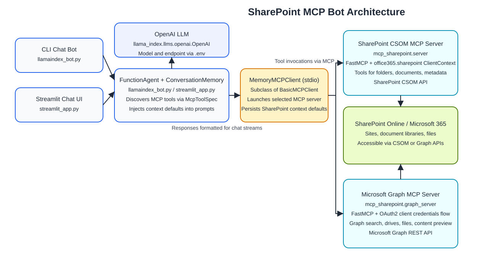
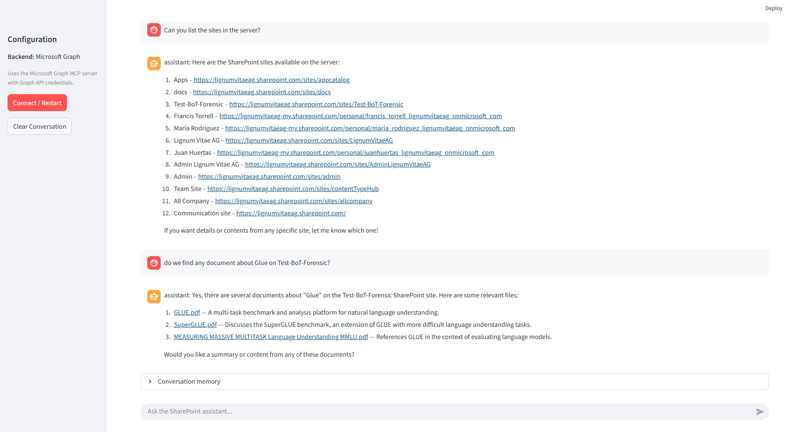

# SharePoint MCP Agent Toolkit

This repository wraps the SharePoint Model Context Protocol (MCP) server with a LlamaIndex-based assistant and two user interfaces:

1. `llamaindex_bot.py` – an interactive CLI loop for quick terminal workflows.
2. `streamlit_app.py` – a Streamlit front end that presents the same agent in a chat-style UI.

Both experiences talk to the `mcp-sharepoint` Python package, which exposes SharePoint data through [Microsoft Graph](https://learn.microsoft.com/en-us/graph/overview) MCP tools.

---

## Architecture Overview

1. **Environment bootstrap** – `.env` values (Graph credentials, OpenAI key, defaults) load via `python-dotenv`.
2. **MCP server launch** – the Graph backend (`mcp_sharepoint.graph_server`) runs as a Python subprocess using stdio pipes.
3. **MCP client** – `MemoryMCPClient` subclasses `BasicMCPClient` to inject conversation defaults (site URL, drive ID, folder path, file references).
4. **LlamaIndex FunctionAgent** – plans MCP tool calls, invokes them, and synthesizes natural-language responses.
5. **User interface** – CLI or Streamlit forwards prompts and renders responses while exposing the current conversation memory.

```
User ➜ (CLI / Streamlit) ➜ LlamaIndex FunctionAgent ➜ MemoryMCPClient ➜ MCP Server ➜ Microsoft Graph ➜ SharePoint
```



### Technologies

- **LlamaIndex FunctionAgent** – orchestrates reasoning and tool invocation.
- **Microsoft Graph** – authoritative API for SharePoint data and files.
- **Model Context Protocol** – standardizes tools/resources so any MCP-compatible client can drive the server.
- **Streamlit** – optional browser UI built on the same Python backend.

---

## Prerequisites & Configuration

### Microsoft Graph application

1. Register an Azure AD application that uses the **client credentials** flow.
2. Grant **application permissions**: `Sites.Read.All` and `Files.Read.All`.
3. Capture the following values (see [Graph overview](https://learn.microsoft.com/en-us/graph/overview) for background):

| Variable        | Description                                            |
|-----------------|--------------------------------------------------------|
| `SHAREPOINT_URL`| Tenant root, e.g., `https://contoso.sharepoint.com`    |
| `TENANT_ID`     | Azure AD tenant (directory) ID                         |
| `CLIENT_ID`     | App registration (client) ID                           |
| `CLIENT_SECRET` | Client secret for the registration                     |

### OpenAI (or compatible) LLM

| Variable        | Description                                                     |
|-----------------|-----------------------------------------------------------------|
| `OPENAI_API_KEY`| Secret used by LlamaIndex to call the model                     |
| `OPENAI_BASE_URL` *(optional)* | Override API host (Azure OpenAI, custom proxy, etc.) |
| `OPENAI_MODEL` *(optional)*    | Defaults to `gpt-4.1-mini`                         |

### Optional SharePoint defaults

Legacy CSOM variables prefixed with `SHP_` can remain in `.env`; they are ignored when you run the Graph backend but still useful if you ever revive CSOM.

- `MCP_DEFAULT_SITE_URL` *(optional)* – preloads the assistant's conversation memory with a specific SharePoint site (e.g., `https://contoso.sharepoint.com/sites/ProjectX`) so prompts like "search this site" work immediately.
- `GRAPH_SEARCH_REGION` *(optional)* – forces Microsoft Search queries to a specific geo (e.g., `EUR`, `NAM`, `APAC`). Required when using application permissions with the Graph Search API; defaults to `NAM` if omitted.

> **Important:** Microsoft Search will not infer this value for app-only tokens. If your tenant is hosted in Switzerland, set `GRAPH_SEARCH_REGION=CHE`; for North America use `NAM`, for Europe use `EUR`, etc. The MCP server cannot query the tenant for this automatically, so the environment variable is the source of truth.

### Example `.env`

```
OPENAI_API_KEY=sk-...
OPENAI_MODEL=gpt-4.1-mini
SHAREPOINT_URL=https://contoso.sharepoint.com
TENANT_ID=00000000-0000-0000-0000-000000000000
CLIENT_ID=11111111-1111-1111-1111-111111111111
CLIENT_SECRET=super-secret
GRAPH_SEARCH_REGION=EUR
```

#### Microsoft Search region reference

| Region code | Geography            | Notes |
|-------------|----------------------|-------|
| `NAM`       | North America        | Default if unset |
| `EUR`       | European Union       | Use for most EU-hosted tenants |
| `CHE`       | Switzerland          | Required for Swiss-based tenants |
| `GBR`       | United Kingdom       | Use for UK sovereign cloud |
| `APAC`      | Asia Pacific         | General APAC geo |

Microsoft does not expose an API to read the tenant's Microsoft Search geo, so choose the value that matches your tenant's data residency. Setting the wrong code causes `/search/query` to return HTTP 400 (`Region is required...`).

---

## Installation

```powershell
python -m venv .venv
.\.venv\Scripts\activate
pip install -r requirements.txt
```

This installs the SharePoint MCP server in editable mode plus LlamaIndex, Streamlit, and helper libraries.

---

## Command-Line Agent (`llamaindex_bot.py`)

```powershell
python llamaindex_bot.py --backend graph
```

What it does:

- Loads `.env`, validates required Graph/OpenAI keys, and extends `PYTHONPATH` with `mcp-sharepoint/src` for local development.
- Spawns the Graph MCP server (`python -m mcp_sharepoint.graph_server`).
- Discovers MCP tools through `McpToolSpec` and feeds them to a LlamaIndex `FunctionAgent` backed by your chosen OpenAI-compatible model.
- Uses `ConversationMemory` to remember the last site/drive/folder/file so you can say “open the third file” or “use the same site” without restating parameters.
- Accepts `exit`, `quit`, or `Ctrl+C` to terminate the session.

### One-shot helper

```powershell
python list_sharepoint_folders.py
```

This script sends a single LlamaIndex prompt that instructs the MCP server to enumerate the configured document library.


---

## Streamlit Chat UI (`streamlit_app.py`)

```powershell
streamlit run streamlit_app.py
```

Highlights:

- Reuses the exact same agent, MCP client, and memory stack as the CLI.
- Runs the MCP Graph backend once and keeps the async event loop alive in a background thread for stable multi-turn chats.
- Sidebar buttons let you connect/restart the backend and clear chat history; the main pane shows chat bubbles plus the “conversation memory” context block.
- Honors the same `.env` file—launch Streamlit from the repo root so variables load automatically.

Troubleshooting tips:

- Set `MCP_CLIENT_DEBUG=1` before launching if you want verbose MCP tool traces in the terminal.
- Restart the Streamlit session after updating `.env` to pick up new credentials.

---

## MCP Tools Exposed by `mcp-sharepoint`

| Tool              | Purpose |
|-------------------|---------|
| `list_sites`      | Enumerate SharePoint sites accessible to the service principal |
| `get_site_info`   | Fetch metadata for a specific site by URL or ID |
| `list_site_drives`| List document libraries/drives inside the selected site |
| `list_drive_items`| Page through folders and files within a drive or folder path |
| `get_file_content`| Retrieve file contents (text/binary awareness handled by MCP) |
| `search_files`    | (Optional) Run Microsoft Graph search queries across content |

Each tool maps directly to a Microsoft Graph call. The MCP layer handles auth, pagination, and result serialization so LlamaIndex can invoke the tool by name.

### Supported file types

The Graph MCP server converts common SharePoint formats to text previews before returning them to the agent (see `mcp_sharepoint/content_utils.py`).

| Category | Extensions |
|----------|------------|
| Plain text / code | `.txt`, `.csv`, `.json`, `.xml`, `.html`, `.md`, `.js`, `.css`, `.py` |
| PDF | `.pdf` |
| Excel | `.xlsx`, `.xls` |
| Word | `.docx`, `.doc` |

Binary content outside these extensions is still retrievable as base64 blobs, but it will not receive an automatic text summary in the assistant response.

### Searching for documents

The `search_files` tool forwards your query to Microsoft Search via Graph and returns ranked `driveItem` hits. The screenshot below (`docs/search.jpg`) shows a sample "Glue" search after setting `GRAPH_SEARCH_REGION` to match the tenant geo and seeding `MCP_DEFAULT_SITE_URL` so the agent knows which site to scan.



Each result includes the SharePoint web URL; click it to open the file directly in your browser. Some formats (e.g., Word, Excel, PDF) open in the Microsoft 365 web viewers automatically, while others require an installed desktop application with an associated protocol handler.

Looking to add vector or hybrid search? See `docs/SEMANTIC_SEARCH.md` for a step-by-step blueprint covering indexing, embeddings, vector stores, and UI/tooling updates.

---

## How the Flow Works

1. **Prompt ingestion** – The UI forwards your natural-language request to the agent.
2. **Context injection** – `ConversationMemory.render_context_prefix()` adds the last known site/drive/folder/file info to the prompt if available.
3. **Planning** – LlamaIndex selects the right MCP tool(s) and prepares arguments.
4. **Execution** – `MemoryMCPClient` fills in missing parameters (site URL, drive ID, folder path, prior item IDs) and sends the request over stdio to the MCP server.
5. **Graph interaction** – The MCP server authenticates with Microsoft Graph, executes the action, and returns structured JSON.
6. **Response synthesis** – The agent summarizes tool output, updates memory, and returns the answer to the CLI or Streamlit UI.

Because memory lives in the Python process, you can restart the UI at any time. The Graph backend itself is stateless beyond each request.

---

## Authentication Flow

This project follows the Microsoft identity platform guidance described in [Register an application for Microsoft Graph](https://learn.microsoft.com/en-us/graph/auth-register-app-v2):

1. **App registration** – create an Azure AD application, enable the *client credentials* flow, and record the `CLIENT_ID`, `TENANT_ID`, and generated client secret.
2. **Permissions** – grant the app the Microsoft Graph application permissions `Sites.Read.All` and `Files.Read.All`, then click “Grant admin consent.”
3. **Token acquisition** – at runtime the MCP server exchanges your credentials for an app-only access token via `https://login.microsoftonline.com/{TENANT_ID}/oauth2/v2.0/token`.
4. **Graph calls** – every MCP tool call includes the bearer token in the `Authorization` header when hitting endpoints such as `/sites/{siteId}` or `/drives/{driveId}/root`.

Because app-only OAuth tokens inherit their privileges from the Azure AD registration, treat your `.env` secrets carefully and rotate the client secret per your organization’s policy.

---

## Operational Tips

- **Rotate credentials**: update `.env` when the Graph client secret changes, then restart CLI/Streamlit.
- **Debugging**: set `MCP_CLIENT_DEBUG=1` to log tool arguments/responses; use Streamlit’s log panel for UI errors.
- **Extending tools**: add new MCP tools under `mcp-sharepoint/src/mcp_sharepoint/tools.py`; they become immediately available to both UIs after restarting.
- **Headless use**: the MCP server can also be registered with other MCP clients (e.g., Claude Desktop) if you need a different front end.

---

## Further Reading

- `mcp-sharepoint/README.md` – server internals, validation notes, and limits.
- [Microsoft Graph documentation](https://learn.microsoft.com/en-us/graph/overview) – API reference and conceptual guides when adding new SharePoint actions.
- [LlamaIndex MCP guide](https://developers.llamaindex.ai/python/framework/module_guides/mcp/llamaindex_mcp/) – deeper dive into the FunctionAgent + MCP integration used here.

