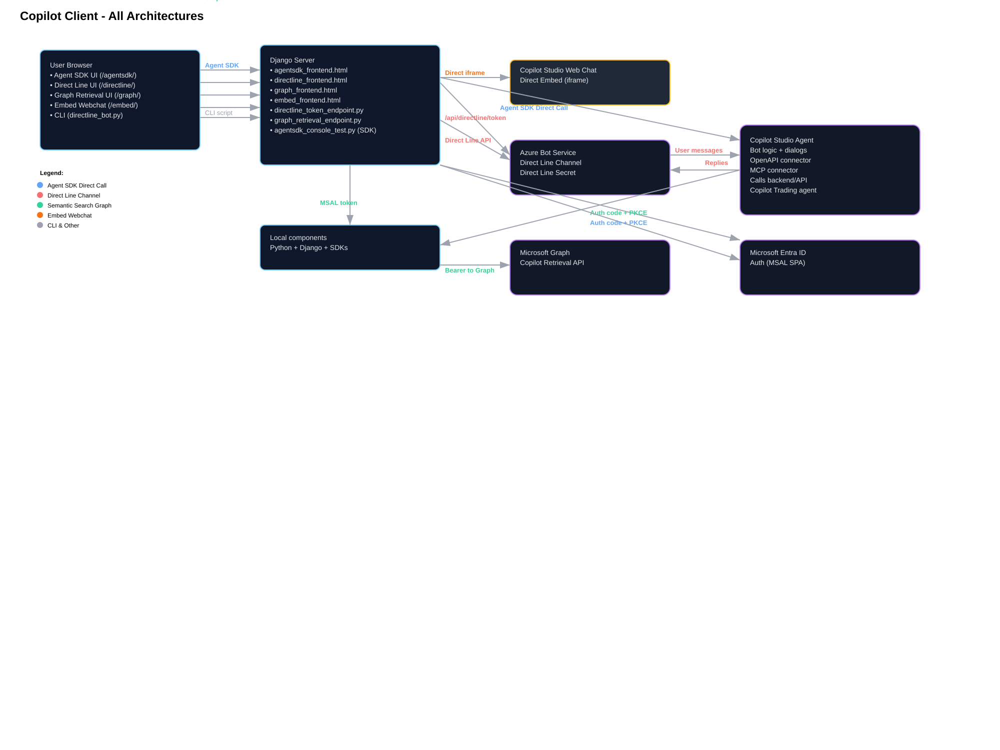

# Cliente Copilot - Demo de Integración Completa

Una demo completa basada en Django que muestra cuatro formas diferentes de integrar con agentes de Microsoft Copilot Studio y búsqueda semántica de Microsoft Graph:

- **Agent SDK Interactive** (`/agentsdk/`): Llamadas directas al SDK con autenticación delegada
- **Direct Line Webchat** (`/directline/`): Canal de Azure Bot Service con UI web
- **Graph Retrieval** (`/graph/`): Búsqueda semántica en contenido de Microsoft 365
- **Embed Webchat** (`/embed/`): Integración iframe simple del web chat de Copilot Studio

## Resumen de Arquitectura



**Flujos codificados por colores:**
- 🔵 **Azul**: Agent SDK Direct Call - Conexión directa a Copilot Studio
- 🔴 **Rojo**: Direct Line Channel - A través de Azure Bot Service
- 🟢 **Verde**: Semantic Search Graph - API de Microsoft Graph Copilot Retrieval
- 🟠 **Naranja**: Embed Webchat - Iframe directo de Copilot Studio

## Inicio Rápido

```bash
# Instalar dependencias
pip install -r requirements.txt

# Copiar y configurar entorno
cp .env.example .env
# Editar .env con tus credenciales

# Ejecutar el servidor
python manage.py runserver

# Acceder a las interfaces:
# - Agent SDK: http://127.0.0.1:8000/agentsdk/
# - Direct Line: http://127.0.0.1:8000/directline/
# - Graph Search: http://127.0.0.1:8000/graph/
# - Embed Chat: http://127.0.0.1:8000/embed/
```

## 1. Agent SDK Interactive (`/agentsdk/`)

Integración directa usando Copilot Studio SDK con autenticación delegada.

### Tecnologías
- **Microsoft Copilot Studio SDK**: Llamadas directas a APIs de agentes
- **MSAL.js**: Autenticación delegada basada en navegador (auth code + PKCE)
- **Backend Django**: Integración SDK del lado servidor

### Cómo funciona
- El navegador se autentica vía MSAL.js con scopes de Power Platform
- El backend Django recibe tokens y hace llamadas directas al SDK de Copilot Studio
- Conversación en tiempo real sin infraestructura de Azure Bot Service

### Flujo de Autenticación
1. **Autenticación en navegador**: MSAL.js redirige a Microsoft login con scope `https://api.powerplatform.com/CopilotStudio.Copilots.Invoke`
2. **Intercambio de tokens**: Django backend recibe código de autorización, lo intercambia por token de acceso
3. **Llamadas SDK**: Conexión directa a API de agente de Copilot Studio
4. **Conversación**: Mensajes enviados/recibidos vía SDK sin intermediarios

### Configuración
Ver [docs/agentsdk-interactive.es.md](docs/agentsdk-interactive.es.md) para configuración detallada incluyendo:
- Requisitos de app registration en Entra
- Permisos de Power Platform API
- Variables de entorno (`M365_*` prefixed)

### Archivos
- Frontend: [copilot_agent/templates/agentsdk_frontend.html](copilot_agent/templates/agentsdk_frontend.html)
- Backend: [agentsdk_console_test.py](agentsdk_console_test.py) (lógica SDK)
- Docs: [docs/agentsdk-interactive.es.md](docs/agentsdk-interactive.es.md)

## 2. Direct Line Webchat (`/directline/`)

Integración tradicional de Azure Bot Service usando canal Direct Line.

### Tecnologías
- **Azure Bot Service**: Aloja el registro del bot y canales
- **Direct Line Channel**: Transporte REST para clientes personalizados
- **Django**: Generación de tokens y alojamiento de UI

### Cómo funciona
- Generación de tokens del lado servidor usando secret de Direct Line
- Navegador establece conversación vía API REST de Direct Line
- Polling en tiempo real para mensajes y respuestas del bot
- Soporte para tarjetas OAuth de autenticación delegada

### Flujo de Autenticación
1. **Secret del lado servidor**: Django mantiene `DIRECT_LINE_SECRET` de forma segura
2. **Generación de tokens**: `/api/directline/token/` intercambia secret por tokens de corta duración
3. **Uso en cliente**: Navegador usa token para todas las llamadas API de Direct Line
4. **OAuth del bot**: Si el agente requiere autenticación, las tarjetas OAuth activan flujo de sign-in del usuario

### Configuración
Ver [docs/directline-webchat.es.md](docs/directline-webchat.es.md) para configuración incluyendo:
- Configuración de Azure Bot Service
- Setup del canal Direct Line
- Variables de entorno (`DIRECT_LINE_*` prefixed)

### Archivos
- Frontend: [copilot_agent/templates/directline_frontend.html](copilot_agent/templates/directline_frontend.html)
- Servicio de tokens: [directline_token_endpoint.py](directline_token_endpoint.py)
- Alternativa CLI: [directline_bot.py](directline_bot.py)
- Docs: [docs/directline-webchat.es.md](docs/directline-webchat.es.md)

## 3. Graph Retrieval (`/graph/`)

Búsqueda semántica a través de contenido Microsoft 365 usando Microsoft Graph Copilot Retrieval API.

### Tecnologías
- **Microsoft Graph Copilot Retrieval API**: Búsqueda semántica avanzada
- **MSAL.js**: Autenticación delegada para Microsoft Graph
- **Django backend**: Procesamiento de consultas y resultados
- **M365 Copilot**: Licencia requerida para acceso a datos

### Cómo funciona
- Usuario autentica vía MSAL.js con scopes de Microsoft Graph
- Frontend envía consultas de búsqueda semántica al backend Django
- Django llama a Microsoft Graph Copilot Retrieval API
- Resultados se muestran en interfaz web con resaltado de relevancia

### Flujo de Autenticación
1. **Registro de app separado**: App dedicada para Graph con permisos específicos
2. **Scopes delegados**: `CopilotPackages.Read.All` para acceso a paquetes Copilot
3. **Admin consent**: Requerido para permisos Graph avanzados
4. **Token de usuario**: Autenticación delegada mantiene contexto de usuario

### Configuración
Ver [docs/graph-retrieval.es.md](docs/graph-retrieval.es.md) y [docs/graph-frontend.es.md](docs/graph-frontend.es.md) para:
- Configuración de app registration Graph
- Setup de fuentes de datos Copilot
- Variables de entorno (`GRAPH_*` prefixed)

### Archivos
- Frontend: [copilot_agent/templates/graph_frontend.html](copilot_agent/templates/graph_frontend.html)
- Backend: [graph_retrieval_endpoint.py](graph_retrieval_endpoint.py)
- Docs: [docs/graph-retrieval.es.md](docs/graph-retrieval.es.md), [docs/graph-frontend.es.md](docs/graph-frontend.es.md)

## 4. Embed Webchat (`/embed/`)

Integración simple iframe usando el web chat embebido por defecto de Copilot Studio.

### Tecnologías
- **Copilot Studio Web Chat**: Embed hospedado por Microsoft por defecto
- **Django TemplateView**: Alojamiento simple de iframe
- **URLs configurables**: Soporte para endpoints de embed personalizados

### Cómo funciona
- Django sirve una página HTML simple con iframe
- Iframe carga la interfaz de web chat por defecto de Copilot Studio
- No se requiere autenticación personalizada o procesamiento backend
- Conexión directa al chat hospedado de Copilot Studio

### Configuración
Ver [docs/embed-webchat.es.md](docs/embed-webchat.es.md) para:
- Configuración de URL de embed por defecto
- Overrides de URL de embed personalizada
- Variable de entorno (`M365_EMBED_URL`)

### Archivos
- Template: [copilot_agent/templates/embed_frontend.html](copilot_agent/templates/embed_frontend.html)
- Docs: [docs/embed-webchat.es.md](docs/embed-webchat.es.md)

## Tecnologías Core

### Autenticación y Seguridad
- **MSAL.js**: Flujos OAuth 2.0 (auth code + PKCE) en navegador
- **Microsoft Entra ID**: Gestión de identidad y acceso
- **Direct Line Secrets**: Generación de tokens del lado servidor
- **App Registrations**: Apps separadas para diferentes tipos de integración

### Framework Backend
- **Django**: Framework web con vistas async y sistema de plantillas
- **SDKs**: CopilotStudio SDK, M365Copilot SDK (beta)
- **Clientes HTTP**: httpx para llamadas API REST

### Componentes Frontend
- **HTML/CSS/JavaScript**: Componentes web vanilla
- **Integración MSAL.js**: Manejo de autenticación
- **Actualizaciones en tiempo real**: Polling y alternativas WebSocket
- **Diseño responsive**: Interfaces amigables para móviles

## Configuración de Entorno

Copiar `.env.example` a `.env` y configurar:

### Para Agent SDK (`/agentsdk/`):
```bash
M365_CONNECTION_STRING=...
M365_ENVIRONMENT_ID=...
M365_TENANT_ID=...
M365_AGENT_APP_ID=...
M365_SCHEMA_NAME=...
M365_SCOPE=...
M365_SCOPE_PYTHON=...
```

### Para Direct Line (`/directline/`):
```bash
DIRECT_LINE_SECRET=...
DIRECT_LINE_BASE_URL=...
```

### Para Graph Retrieval (`/graph/`):
```bash
TENANT_ID=...
CLIENT_ID_2=...
GRAPH_SCOPES=...
COPILOT_DATA_SOURCE=...
```

### Para Embed (`/embed/`):
```bash
M365_EMBED_URL=...  # Opcional
```

## Requisitos de Cloud Setup

### App Registrations de Microsoft Entra ID
- **App Agent SDK**: Permisos Power Platform API, URIs redirect SPA
- **App Graph**: Permisos Microsoft Graph, URIs redirect SPA
- **App Direct Line**: URLs de exchange de tokens del Bot Framework

### Recursos Azure
- **Azure Bot Service**: Para integraciones Direct Line
- **Copilot Studio**: Creación y publicación de agentes
- **Microsoft 365**: Para Graph retrieval (licencia Copilot requerida)

### Permisos y Consentimiento
- **Permisos delegados**: Para flujos interactivos de usuario
- **Permisos de aplicación**: Para llamadas service-to-service
- **Admin consent**: Requerido para muchos scopes de Microsoft Graph

## Instalación y Setup

```bash
# Instalar dependencias Python
pip install -r requirements.txt

# Setup de base de datos (opcional)
python manage.py migrate

# Configurar variables de entorno
cp .env.example .env
# Editar .env con tus credenciales

# Iniciar servidor de desarrollo
python manage.py runserver
```

## Mejores Prácticas de Seguridad

- **Nunca hacer commit de `.env`** o secretos al control de versiones
- **Rotar secretos regularmente** (Direct Line, client secrets)
- **Usar servidores de producción** (gunicorn/uvicorn + nginx) para despliegues
- **Implementar CORS apropiado** en producción
- **Monitorizar uso de tokens** e implementar rate limiting
- **Usar Azure Key Vault** o similar para gestión de secretos

## Solución de Problemas

### Problemas Comunes

**Problemas Agent SDK:**
- **Power Platform API no disponible**: Seguir [docs/agentsdk-interactive.es.md](docs/agentsdk-interactive.es.md) para crear service principal
- **Errores de scope**: Verificar permiso `CopilotStudio.Copilots.Invoke` concedido

**Problemas Direct Line:**
- **Fallo en obtención de token**: Verificar `DIRECT_LINE_SECRET` y región coinciden
- **Sin respuestas**: Verificar agente publicado y Direct Line habilitado

**Problemas Graph Retrieval:**
- **Fallo de autenticación**: Verificar scopes Graph y admin consent
- **Sin resultados**: Verificar licenciamiento M365 Copilot y acceso a fuente de datos

**Problemas Generales:**
- **Template not found**: Verificar archivos de plantilla existen
- **Errores de red**: Verificar firewall y configuración proxy
- **Problemas CORS**: Configurar orígenes permitidos en producción

## Referencias de Documentación

- [Guía de Autenticación y Seguridad](docs/authentication-guide.es.md)
- [Guía Agent SDK Interactive](docs/agentsdk-interactive.es.md)
- [Setup Direct Line Webchat](docs/directline-webchat.es.md)
- [Configuración Graph Retrieval](docs/graph-retrieval.es.md)
- [Detalles Graph Frontend](docs/graph-frontend.es.md)
- [Setup Embed Webchat](docs/embed-webchat.es.md)

## Diagrama de Arquitectura

El [docs/architecture.svg](docs/architecture.svg) proporciona una visión general visual completa de todos los patrones de integración, flujos de autenticación, y relaciones entre componentes. La leyenda codificada por colores explica cada patrón arquitectural y tipo de conexión.

---

*Esta demo muestra múltiples enfoques de integración para Microsoft Copilot Studio y APIs Graph. Elige el patrón que mejor se ajuste a tus requerimientos de seguridad, escalabilidad y experiencia de usuario.*

### Tecnologías
