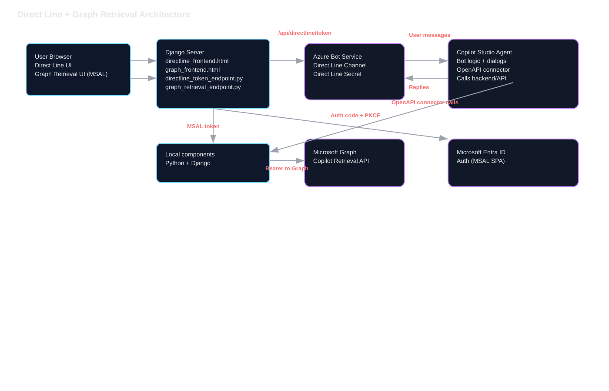
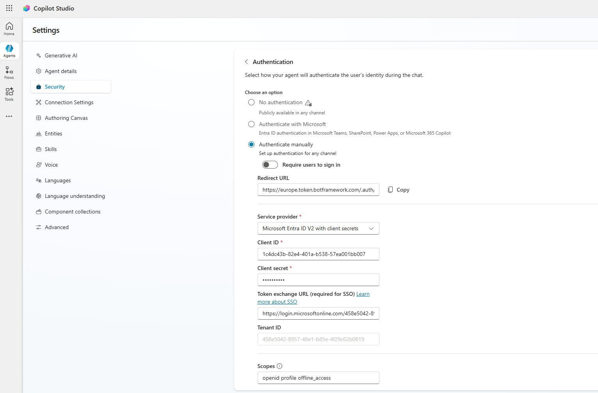

# Cliente de Copilot por Direct Line

Chatea con tu agente de Copilot sobre Azure Bot Service Direct Line mediante una interfaz web (Django) o un script de línea de comandos.

## Arquitectura


### Tecnologías clave (ruta Direct Line)
- Microsoft Copilot Studio: aquí se crea y publica el agente; el canal Direct Line expone ese agente a clientes personalizados. Docs: https://learn.microsoft.com/microsoft-copilot-studio/
- Azure Bot Service + Bot Framework: aloja el bot registration y los canales. Docs: https://learn.microsoft.com/azure/bot-service/
- Direct Line channel: transporte REST que usan la web UI y la CLI; los tokens se generan en servidor con el Direct Line secret. Docs: https://learn.microsoft.com/azure/bot-service/bot-service-channel-directline
- Django: servidor ligero para hospedar la UI, exponer el endpoint de token y servir las plantillas. Docs: https://docs.djangoproject.com/en/5.0/
- httpx: cliente HTTP del servidor para llamar a `tokens/generate` de Direct Line. Docs: https://www.python-httpx.org/

### Cómo funciona la app de Direct Line (end to end)
- Punto de entrada: la ruta raíz `/` renderiza la UI de chat desde [copilot_agent/templates/directline_frontend.html](copilot_agent/templates/directline_frontend.html). La plantilla inyecta `DIRECT_LINE_BASE_URL` desde settings para que el navegador sepa a qué región de Direct Line llamar.
- Emisión de token: al cargar, la página llama a `/api/directline/token/` (vista Django en [directline_token_endpoint.py](directline_token_endpoint.py)). Esa vista intercambia el `DIRECT_LINE_SECRET` del servidor por un token de Direct Line de corta duración con `POST {DIRECT_LINE_BASE_URL}/v3/directline/tokens/generate` usando `httpx`. El secret nunca se envía al navegador.
- Inicio de conversación: el navegador hace `POST {DIRECT_LINE_BASE_URL}/v3/directline/conversations` con el token para obtener `conversationId`. La UI lo muestra para poder correlacionar con los logs del Bot Service.
- Mensajería: los mensajes de salida van a `/v3/directline/conversations/{conversationId}/activities` con el mismo bearer token. El JS etiqueta al remitente como `user1` para filtrar sus propios eco al renderizar.
- Polling y watermark: el navegador hace polling de `/activities` cada ~1.2s usando la última watermark para evitar duplicados. Las respuestas y attachments del bot se renderizan como burbujas. Hay soporte mínimo de markdown (bold y bullets).
- OAuth cards: si el bot envía un attachment `application/vnd.microsoft.card.oauth`, la UI muestra el enlace de sign-in. Tras iniciar sesión y obtener el magic code, el usuario lo pega; la UI envía ese código como siguiente mensaje y completa el flujo OAuth para el bot.
- Vida del token: los tokens de Direct Line son de corta duración (por defecto ~30 minutos) pero la conversación vive más. Al recargar la página se pide un token nuevo y se arranca una conversación nueva.

### Flujo de autenticación (Direct Line)
1) Secret en servidor: configuras `DIRECT_LINE_SECRET` y opcionalmente `DIRECT_LINE_BASE_URL` en `.env`. Los settings solo exponen la base URL al cliente; el secret nunca sale del servidor.
2) Intercambio de token: [directline_token_endpoint.py](directline_token_endpoint.py) usa el secret para llamar al endpoint `tokens/generate` de Direct Line y devuelve solo `{ token, expires_in }` al navegador.
3) Uso en el cliente: el navegador usa ese token para todas las llamadas REST de Direct Line (start conversation, send activities, poll activities). No se usan tokens de Graph ni de otras apps en este flujo.
4) OAuth iniciado por el bot: si tu Copilot/agent dispara sign-in, envía una OAuth card por Direct Line. La UI indica abrir el enlace, completar login y pegar el magic code, que el bot valida para cerrar la autenticación delegada.

### Responsabilidades de componentes (ver docs/architecture.svg)
- Presentación: [copilot_agent/templates/directline_frontend.html](copilot_agent/templates/directline_frontend.html) contiene la UI de una sola página y toda la lógica de cliente de Direct Line (token fetch, start conversation, send, poll, manejo de OAuth card).
- Superficie API: [copilot_agent/urls.py](copilot_agent/urls.py) mapea `/` a la UI de chat y `/api/directline/token/` a la vista de token. Los endpoints de Graph también se registran ahí pero son independientes de Direct Line.
- Servicio de tokens: [directline_token_endpoint.py](directline_token_endpoint.py) es el único lugar donde se usa el secret de Direct Line. Emite tokens efímeros y devuelve JSON; los fallos incluyen el cuerpo de la respuesta aguas arriba para diagnóstico.
- Alternativa CLI: [directline_bot.py](directline_bot.py) reproduce la misma secuencia (token → conversation → send → poll) para probar local sin la UI web. También maneja OAuth cards pidiendo el magic code en consola.
- Hosting Django: [manage.py](manage.py) levanta el dev server; [copilot_agent/settings.py](copilot_agent/settings.py) conecta variables de entorno como `DIRECT_LINE_BASE_URL` y rutas de templates.

## Componentes (archivos clave)
- Servidor web (Django): [manage.py](manage.py), [copilot_agent/settings.py](copilot_agent/settings.py), [copilot_agent/urls.py](copilot_agent/urls.py), vista de token [directline_token_endpoint.py](directline_token_endpoint.py), plantilla de UI [copilot_agent/templates/directline_frontend.html](copilot_agent/templates/directline_frontend.html).
- API/UI de Graph retrieval: [graph_retrieval_endpoint.py](graph_retrieval_endpoint.py), plantilla [copilot_agent/templates/graph_frontend.html](copilot_agent/templates/graph_frontend.html) en `/graph`.
- Chat por CLI: [directline_bot.py](directline_bot.py).
- Ejemplo de entorno: [.env.example](.env.example) (cópialo a `.env`).

## Requisitos
- Python 3.9+ recomendado.
- Direct Line secret de tu Azure Bot Service > Channels > Direct Line.
- Si tu agente/herramienta usa OAuth, ten lista la app registration de Entra (client id/secret, tenant).
- Para la UI de Graph retrieval: service principal con client secret y los Graph scopes consentidos (ver captura de permisos de API); soporta múltiples scopes vía `GRAPH_SCOPES`.

## Configuración en la nube (Azure + Copilot Studio)
1) App registration en Entra ID (para la conexión OAuth de tu herramienta)
- Tipo de app: Web app single-tenant.
- Redirect: `https://<region>.token.botframework.com/.auth/web/redirect` (coincide con tu región de Direct Line; ej. Europa → `https://europe.token.botframework.com/.auth/web/redirect`).
- Permisos: delegated `openid profile offline_access` + los scopes de tu API (ej. `api://<api-client-id>/.default`).
- Crea un client secret; guarda tenant id, client id, client secret.

2) Azure Bot Service
- Crea un Bot Channels Registration, pega el mismo client id de la app y elige región.

3) Habilita el canal Direct Line
- En el recurso del bot > Channels > Direct Line > Configure > Add. Copia el Direct Line secret (`DIRECT_LINE_SECRET`). Si usas endpoint regional, anótalo (ej. `https://europe.directline.botframework.com`).

4) Canal Copilot Studio + conexión de herramienta
- En Copilot Studio, conecta el canal del bot al Bot Service creado y publica tu agente.
- Para herramientas que requieren OAuth: define una conexión OAuth con tu app de Entra. Sigue la guía de Microsoft https://learn.microsoft.com/en-us/microsoft-copilot-studio/configure-web-security y la configuración de la captura:
  - Authentication option: **Authenticate manually** (si quieres login en cada chat).
  - Redirect URL: `https://<region>.token.botframework.com/.auth/web/redirect` (ej. región Europa como en la imagen).
  - Service provider: **Microsoft Entra ID V2 with client secrets**.
  - Client ID / Client secret: de tu app registration.
  - Token exchange URL (token endpoint): `https://login.microsoftonline.com/<tenant-id>/oauth2/v2.0/token`.
  - Tenant ID: tu directory ID.
  - Scopes: al menos `openid profile offline_access` más los scopes de tu backend (ej. `api://<api-client-id>/.default`).
- Asegúrate de que la conexión muestre **Connected**, luego vuelve a publicar el agente.

Ejemplo de captura (config de auth en Copilot Studio):


## Instalación
```bash
pip install -r requirements.txt
```

## Configurar
1) Copia la plantilla de entorno y rellena valores:
```bash
cp .env.example .env
# edita .env
```
Claves obligatorias:
- `DIRECT_LINE_SECRET` (Direct Line secret; igual que WEB_CHANNEL_TOKEN en el portal)
- `DIRECT_LINE_BASE_URL` (región, ej. https://europe.directline.botframework.com)
Claves para Graph retrieval (app-only):
- `TENANT_ID`, `CLIENT_ID_2` (o `CLIENT_ID`), `CLIENT_SECRET`
- `GRAPH_SCOPES` (separados por espacio; por defecto `https://graph.microsoft.com/.default`, requerido para client credentials)
- `COPILOT_DATA_SOURCE` (opcional; por defecto `SharePoint`)
Opcionales si tu bot/herramienta los necesita: `TENANT_ID`, `CLIENT_ID`, `CLIENT_SECRET`, etc.

2) (Si rotas secretos) no hagas commit de `.env`. Prefiere variables de entorno en tu shell o un secret store.

## Ejecutar el chat web (recomendado)
```bash
python manage.py migrate   # primera vez, opcional para admin/auth
python manage.py runserver
```
Luego abre http://127.0.0.1:8000/

Qué sucede:
- El frontend se renderiza desde [copilot_agent/templates/directline_frontend.html](copilot_agent/templates/directline_frontend.html) y llama a `/api/directline/token/`.
- El endpoint de token [directline_token_endpoint.py](directline_token_endpoint.py) usa `DIRECT_LINE_SECRET` para emitir un token de Direct Line de corta duración.
- La página inicia una conversación contra `DIRECT_LINE_BASE_URL` y recibe/manda mensajes en streaming.

## Ejecutar la UI de Graph retrieval
```bash
python manage.py runserver
```
Abre http://127.0.0.1:8000/graph/ y envía una consulta. El backend en `/api/graph/retrieval/` usa credenciales de app para llamar a Microsoft Graph Copilot retrieval API. Asegura que tu service principal tiene los scopes consentidos (ver captura en docs/Securiry_copilot_auth.png y permisos de API) y que `TENANT_ID`, `CLIENT_ID_2`/`CLIENT_ID`, `CLIENT_SECRET` y `GRAPH_SCOPES` (usa `.default`) estén definidos.

## Ejecutar el chat por CLI (alternativa)
```bash
python directline_bot.py
```
Escribe para chatear; `exit` para salir.

## Tarjetas OAuth (magic code)
Si el bot envía una OAuth card, abre el enlace de inicio de sesión, completa el login, copia el magic code mostrado y envíalo como siguiente mensaje.

## Solución de problemas
- **Template not found**: verifica que [copilot_agent/templates/directline_frontend.html](copilot_agent/templates/directline_frontend.html) exista; settings incluye esa ruta.
- **Fallo al obtener token**: confirma que `DIRECT_LINE_SECRET` está definido y es válido; la región coincide con `DIRECT_LINE_BASE_URL`.
- **Fallo en Graph retrieval**: verifica `TENANT_ID`, `CLIENT_ID`/`CLIENT_ID_2`, `CLIENT_SECRET` y `GRAPH_SCOPES`; para client credentials usa `.default` (ej. `https://graph.microsoft.com/.default`) y que la app tenga los Graph app permissions con admin consent.
 - Si ves `AADSTS1002012` / scope invalid for client creds: usa `.default` y concede application permissions con admin consent.
 - Si ves `Unauthorized` con `.default`: asegúrate de que el service principal tiene Application permissions para los recursos consultados (ej. Files.Read.All, Sites.Read.All) y admin consent; los Copilot delegated scopes no funcionan con client credentials.
- **No hay respuestas**: verifica que el agente está publicado y Direct Line está habilitado; revisa errores de red/console.
- **Aviso de migrations**: opcional en este ejemplo; ejecuta `python manage.py migrate` si necesitas modelos de admin/auth.

## Seguridad
- Nunca hagas commit de `.env` ni secretos.
- Rota los Direct Line secrets regularmente.
- Usa un servidor de producción (gunicorn/uvicorn + reverse proxy) para despliegues reales.
