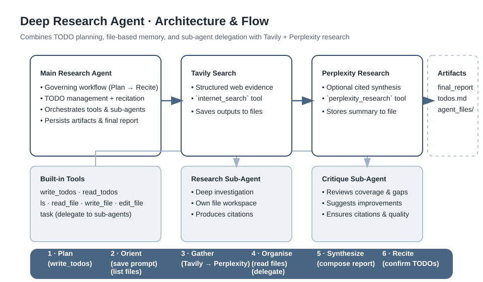

## Agente Inteligente de Ayuda a la Investigación 

Agente de investigación listo para producción construido sobre el stack de [deepagents](https://github.com/langchain-ai/deepagents). El proyecto empaqueta un ejemplo completo que pone en práctica la planificación con TODO, la memoria basada en archivos, la delegación a sub-agentes y una cadena dual de investigación web que integra la búsqueda de Tavily con la síntesis opcional de Perplexity.

## Puntos destacados
- Planificación de tareas con creación obligatoria de TODO, recitación y seguimiento de estado
- Descarga al sistema de archivos para que cada llamada de herramienta guarde artefactos persistentes
- Delegación a sub-agentes para hilos de investigación paralelos y enfocados
- Pipeline dual de investigación: Tavily para evidencia bruta y Perplexity para síntesis con citas cuando está habilitado
- Entradas vía CLI, uso programático y streaming, todas con soporte para exportar artefactos

## Arquitectura



La herramienta opcional Perplexity se conecta al bucle de recolección de evidencias del agente principal para producir una síntesis adicional con citas que se persiste junto a los resultados de Tavily.

## Qué garantiza el agente
- Siempre crea listas TODO para trabajos no triviales, las repasa antes de tomar decisiones importantes y marca el progreso
- Persiste cada artefacto relevante (resumen de TODO, salidas de herramientas, informe final) cuando `--save-artifacts` está activado
- Ejecuta primero la búsqueda de Tavily y en segundo lugar la síntesis de Perplexity siempre que Perplexity esté disponible, guardando cada resultado en archivos separados
- Delegará investigaciones profundas a sub-agentes con contexto aislado cuando se necesite mayor foco

## Preparación

### Requisitos previos
- Python 3.11+
- Clave de API de [Tavily](https://tavily.com)
- Clave de proveedor LLM soportado por LangChain (OpenAI o Anthropic listos para usar)
- Clave de API opcional de [Perplexity](https://www.perplexity.ai/) para la herramienta de síntesis

### Instalar dependencias
```bash
pip install -r requirements.txt
```

Alternativa recomendada con [uv](https://github.com/astral-sh/uv):
```bash
uv pip install -r requirements.txt
```

### Configurar el entorno
1. Copia la plantilla (si está disponible) y crea un archivo `.env` junto a `research_agent.py`.
2. Proporciona las claves necesarias:

```
TAVILY_API_KEY=...
# Elige el proveedor que usarás
OPENAI_API_KEY=...    # si provider=openai
ANTHROPIC_API_KEY=... # si provider=anthropic

# Integraciones opcionales
PERPLEXITY_API_KEY=...
PERPLEXITY_MODEL=sonar-reasoning-pro   # sobreescritura opcional
LANGSMITH_API_KEY=...
LANGSMITH_TRACING=true
LANGSMITH_PROJECT=deep-research-agent
```

Si `PERPLEXITY_API_KEY` está presente y el SDK `perplexity`/`perplexityai` está instalado, el agente expone automáticamente la herramienta `perplexity_research` y hace cumplir el flujo dual de herramientas.

## Ejecutar el agente

```bash
python research_agent.py [--provider openai|anthropic] [--model <model-id>] \
    [--temperature 0.0] [--max-concurrent 3] [--max-iterations 10] \
    [--save-artifacts] [--artifact-dir artifacts]
```

Se te pedirá escoger entre:
- **Example mode** – recorre preguntas de ejemplo para que observes la creación de TODO, el uso de herramientas y la captura de artefactos
- **Interactive mode** – acepta tu propio prompt y produce un informe final de investigación

Cuando se usa `--save-artifacts`, cada ejecución crea una carpeta con marca de tiempo dentro de `--artifact-dir` que contiene:
- `final_report.md` – el mensaje final del asistente
- `todos.md` – cada TODO registrado con su historial de estado
- `agent_files/` – todos los archivos escritos por el agente (volcados de evidencia, resúmenes de Perplexity, borradores) más un índice

## Acceso programático

```python
from research_agent import DeepResearchAgent

agent = DeepResearchAgent(
    provider="openai",             # o "anthropic"
    model_name="gpt-4.1",          # el prefijo del proveedor es opcional si coincide
    temperature=0.0,
    max_concurrent_research_units=3,
    max_researcher_iterations=10,
)

result = agent.research("Latest advances in quantum machine learning")
report = result["messages"][-1].content
print(report)

# Streaming para ver avances en tiempo real
agent.stream_research("Compare EV vs hydrogen fuel adoption constraints")
```

El payload de retorno incluye el mensaje final, la lista TODO capturada y el conjunto completo de archivos escritos por el agente para que los puedas persistir o postprocesar según necesites.

## Tooling

| Tool | Propósito |
|------|-----------|
| `write_todos` / `read_todos` | Gestionar planes de trabajo con estados explícitos |
| `ls`, `read_file`, `write_file`, `edit_file` | Sistema de archivos virtual para descargar contexto |
| `task` | Delegar trabajo a sub-agentes registrados |
| `internet_search` | Búsqueda con Tavily (tema configurable, máximo de resultados, contenido bruto) |
| `perplexity_research` | Síntesis opcional de Perplexity con citas en línea |

Todas las herramientas escriben sus salidas relevantes en archivos como parte del flujo gobernado, garantizando que los artefactos sobrevivan más allá de la conversación.

## Flujo de trabajo en la práctica
1. **Plan** – Escribe de inmediato una lista TODO estructurada que cubre planificación, cada llamada de herramienta, revisión de archivos y tareas de síntesis.
2. **Orient** – Guarda el prompt de la persona usuaria, lista los archivos existentes y revisa contexto previo si lo hubiera.
3. **Gather** – Llama primero a Tavily para almacenar evidencia bruta y luego a Perplexity (cuando esté configurado) para un resumen con citas guardado aparte.
4. **Organise** – Lee los archivos guardados, lanza sub-agentes para profundidades específicas cuando sea necesario y mantiene los TODO sincronizados.
5. **Synthesize** – Produce un informe con citas que referencia toda la evidencia recopilada.
6. **Recite** – Revisa la lista TODO en voz alta, verifica que cada paso se completó y entonces finaliza la respuesta.

## Estructura de artefactos

```
artifacts/
  20251116-101504_latest-advances-in-quantum-ml-and-applications-of-quantum-ml-in-real-world/
    final_report.md
    todos.md
    agent_files/
      index.md
      tavily_findings.md
      perplexity_summary.md
      ...
```

La estructura facilita revisar ejecuciones posteriormente, comparar informes o enviar las salidas a flujos de trabajo posteriores.

## Solución de problemas
- **Missing API keys** – El script se detiene con un error claro que lista las claves faltantes; revisa `.env`.
- **Perplexity tool not listed** – Falta `PERPLEXITY_API_KEY` o el SDK no está instalado (`pip install perplexity` o `pip install perplexityai`).
- **Model mismatch errors** – Asegúrate de que `--provider` coincide con el nombre del modelo; puedes anteponer `provider:model` para evitar la inferencia.
- **Empty artifact folders** – El agente solo persiste archivos cuando `--save-artifacts` está activo; de lo contrario imprime resúmenes en consola.

## Lecturas adicionales
- [Documentación de deepagents](https://docs.langchain.com/oss/python/deepagents/overview)
- [Documentación de LangGraph](https://langchain-ai.github.io/langgraph/)


## Licencia y contribuciones

Este proyecto se ofrece tal cual para fines educativos y de investigación. Siéntete libre de hacer fork y adaptarlo a tus propios casos de uso. Y basado en el curso Deep Agents from Scratch curriculum al cual (DeepLEarning.ai and langchain ) hay que attribuir casi todo el codigo. Yo solo he extendido el codigo introduciendo una segunda heremienta de busqueda (Perplexity) Y modificado la logica para hacer el Agente funcionar como queria, modificando prompts y cambiando la logica principal.  Tambien crear todo la documentacion y video en Español``python
