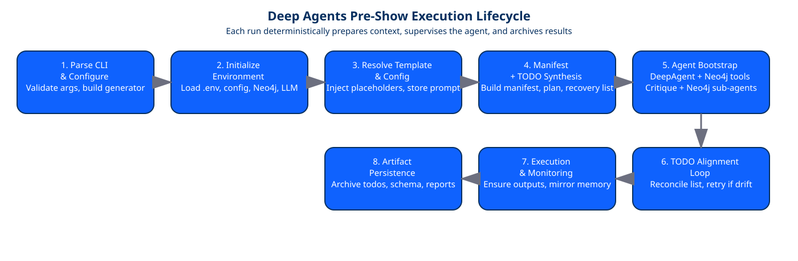
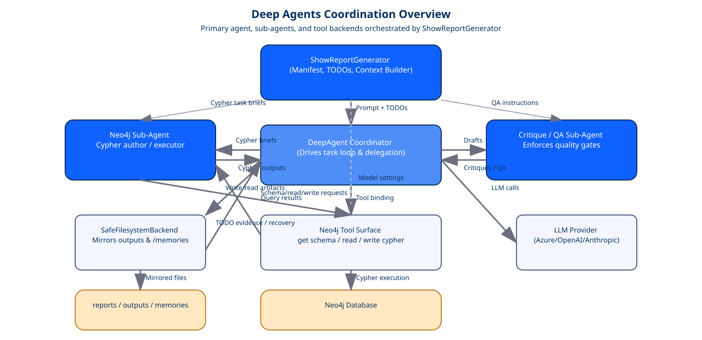
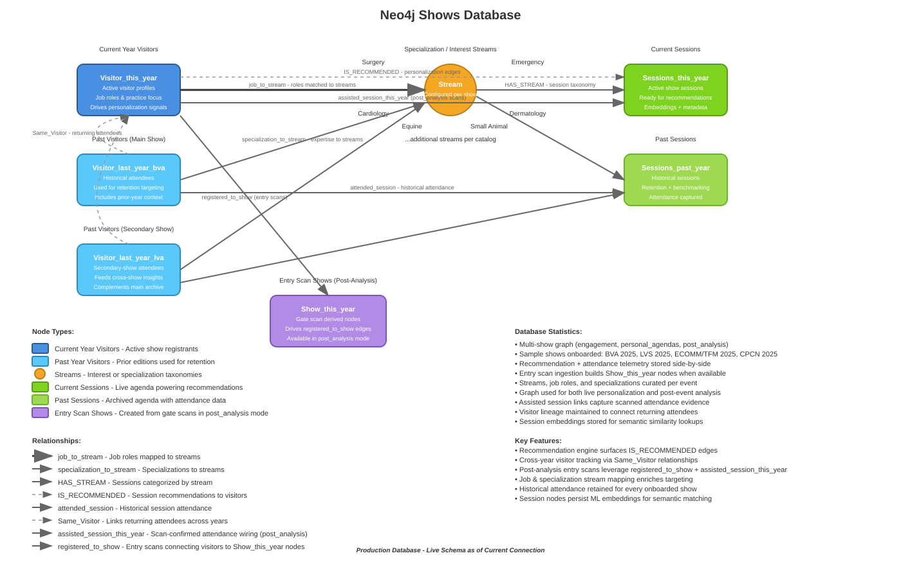

# Deep Agents Show performance Reporting Workflow

An automation layer that scaffolds and executes the 13-task pre-show analytics report using [DeepAgents](https://github.com/deepagents/deepagents), Neo4j, and LangChain-compatible LLMs. The workflow compiles a deterministic TODO plan, primes the agent with schema/config context, and drives the full report generation loop for any supported event configuration.

## What Is DeepAgents?
[DeepAgents](https://docs.langchain.com/oss/python/deepagents/overview) is LangChain's task-driven multi-agent runtime that pairs deterministic TODO manifests with tool-aware sub-agents. Each agent can mount its own tool belt (filesystem, Neo4j, evaluators) while the coordinator enforces ordered execution, retries, and recovery steps. In this project we lean on DeepAgents to: (1) ingest a canonical TODO plan, (2) delegate Cypher-heavy work to a Neo4j specialist, (3) route drafts through a critique sub-agent, and (4) persist every intermediate artifact for auditability.

## Core Capabilities
- **Deterministic orchestration** – builds a task manifest, TODO plan, schema snapshot, and recovery inventory before an LLM is contacted (`arc/pre_show/manifest.py`).
- **Safety-first filesystem access** – proxies DeepAgents file operations through a sandboxed backend that mirrors artifacts into `/memories/<event><year>/pre_show` for disaster recovery (`arc/pre_show/backends.py`).
- **Direct Neo4j tooling** – exposes `get_neo4j_schema`, `read_neo4j_cypher`, and `write_neo4j_cypher` directly to the agent with identifier normalization and query rewriting (`arc/pre_show/generator.py`).
- **LLM provider flexibility** – supports Azure OpenAI, OpenAI, and Anthropic (Claude 4.5) via a unified `ModelSettings` abstraction (`deep_agents_reports/src/models.py`).
- **Artifact persistence** – archives TODO states, agent responses, result files, and schema snapshots under `deep_agents_reports/reports/artifacts/` and `deep_agents_reports/outputs/<event><year>/pre_show/`.

## High-Level Architecture
```
CLI (deep_agents_workflow.py)
    │
    └── ShowReportGnerator (arc/pre_show/generator.py)
          ├─ load_event_config / prompt template resolution
          ├─ manifest + TODO builders (arc/pre_show/manifest.py)
          ├─ prompt/context assembly (arc/pre_show/prompts.py)
          ├─ DeepAgents + SubAgents + Neo4j tools
          ├─ TODO reconciliation + execution loop
          └─ artifact/memory persistence
```
- **CLI** – `deep_agents_workflow.py` parses runtime options and instantiates `ShowReportGnerator`.
- **Generator** – encapsulates init (config, prompt, Neo4j, model), manifest production, DeepAgent creation, execution, and error handling.
- **Backends** – `SafeFilesystemBackend` enforces repo-relative IO with explicit `/memories/` routing for long-term storage.
- **Prompts** – `arc/pre_show/prompts.py` produces the main agent instructions plus sub-agent system prompts (Neo4j analysis + critique QA).

## Technology Stack
- **Language runtime** – Python 3.11 (see `.python-version`).
- **Orchestration** – DeepAgents 0.2.x (task tooling, TODO middleware, sub-agent delegation).
- **LLM access** – LangChain, `langchain-openai`, `langchain-anthropic`, `langchain-mcp-adapters`.
- **Graph layer** – Neo4j 5.x via the official Neo4j Python driver.
- **Configuration** – YAML-driven event configs in `deep_agents_reports/config` and Markdown prompt templates under `deep_agents_reports/reports/prompts`.
- **Package/dependency management** – `requirements.txt` (pip / uv) + `pyproject.toml` for editable installs.

## Repository Layout
| Path | Description |
| --- | --- |
| `deep_agents_workflow.py` | CLI entrypoint that wires args into the generator and prints run summaries. |
| `arc/pre_show/` | Modularized workflow components (generator, manifest helpers, prompts, filesystem backends). |
| `config/` | Event-level YAML files consumed by both the data pipeline and this workflow. |
| `docs/` | Authoring aids (prompt reference, protocol checklists, config guide). |
| `reports/prompts/` | Generic and event-specific instruction templates. |
| `reports/artifacts/` | Auto-generated manifest/TODO/response snapshots per run. |
| `outputs/<event><year>/pre_show/` | Resulting Neo4j schema dumps, JSON exports, and mirrored agent files. |
| `memory/` | Long-term sandbox used by the filesystem backend to persist artifacts across DeepAgents sessions. |

## Prerequisites
1. **Python** – 3.11.x (match `.python-version`).
2. **Neo4j** – Access to a Neo4j instance (4.4+ recommended, 5.x tested) with APOC installed for schema discovery.
3. **Environment variables** – Stored in `keys/.env` or exported prior to launch:
   - `NEO4J_URI_<PROFILE>` (e.g., `NEO4J_URI_TEST=bolt://...`).
   - `NEO4J_PASSWORD_<PROFILE>` and optional global `NEO4J_USERNAME` (defaults to `neo4j`).
   - `OPENAI_API_KEY`, `AZURE_OPENAI_API_KEY`/`AZURE_OPENAI_ENDPOINT`/`AZURE_OPENAI_DEPLOYMENT`, or `ANTHROPIC_API_KEY` depending on provider.
4. **Event configuration** – copy or adjust one of the YAML files in `deep_agents_reports/config`. See `docs/readme_config.md` for field-by-field guidance.
5. **Prompt template** – typically `deep_agents_reports/reports/prompts/prompt_initial_run_generic_short.md` or an event-specific variant.

## Installation
```bash
cd deep_agents_reports
python -m venv .venv
. .venv/Scripts/activate            # PowerShell: ./.venv/Scripts/Activate.ps1
pip install -U pip
pip install -r requirements.txt
# optional editable install for shared libs
pip install -e .
```
> Prefer `uv pip sync requirements.txt` if the `uv` CLI is available; it matches the checked-in `uv.lock`.

## Configuration
### Environment Variables
Create `keys/.env` (or export in your shell):
```env
# Neo4j profiles consumed via --neo4j-profile
NEO4J_URI_DEV=bolt://localhost:7687
NEO4J_URI_TEST=neo4j+s://test.db.neo4j.io
NEO4J_URI_PROD=neo4j+s://prod.db.neo4j.io
NEO4J_USERNAME=neo4j
NEO4J_PASSWORD_DEV=dev-password
NEO4J_PASSWORD_TEST=test-password
NEO4J_PASSWORD_PROD=prod-password

# LLM providers
OPENAI_API_KEY=sk-...
AZURE_OPENAI_API_KEY=...
AZURE_OPENAI_ENDPOINT=https://your-resource.openai.azure.com
AZURE_OPENAI_DEPLOYMENT=gpt-4o-mini
ANTHROPIC_API_KEY=...
```
`ShowReportGnerator` selects the correct URI/password pair based on `--neo4j-profile` and falls back to `NEO4J_USERNAME` if a profile-specific username is not provided.

### Event YAML
Each config under `deep_agents_reports/config` mirrors the broader PA pipeline options (registration/scans/sessions/recommendations). This workflow mainly consumes:
- `mode`, `event.*`, and `neo4j.*` metadata to format prompts and normalize Cypher identifiers.
- `recommendation.similarity_attributes` to expand placeholder queries in the manifest.
- File path hints for output mirroring.
Refer to `docs/readme_config.md` for exhaustive explanations.

### Prompt Templates
Prompt markdown lives in `deep_agents_reports/reports/prompts`. The workflow reads the template, replaces `[PLACEHOLDER]` tokens using config values, and saves the resolved version under `reports/artifacts/processed_prompt_<event><year>.md`. Keep the template synchronized with the TODO manifest expectations (sections labeled `### TASK n` etc.).

## Running the Workflow
```powershell
python deep_agents_workflow.py `
  --event CPCN `
  --year 2025 `
  --config deep_agents_reports\config\config_cpcn.yaml `
  --prompt-template deep_agents_reports\reports\prompts\prompt_initial_run_generic_short.md `
  --neo4j-profile test `
  --neo4j-database neo4j `
  --provider anthropic `
  --model claude-haiku-4-5 `
  --temperature 0.1 `
  --example-report deep_agents_reports\reports\report_cpcn_13112025_short.md `
  --verbose
```
**Key flags**
- `--provider` / `--model` – switch between Azure/OpenAI/Anthropic deployments.
- `--example-report` – optional tone/style reference included in the agent context.
- `--neo4j-profile` – selects the credential set via env vars.
- `--verbose` – raises logging level for troubleshooting.

## Two-Phase Reporting Pipeline
- `reporting_pipeline.py` orchestrates turnkey runs via YAML profiles (see `config/reporting_pipeline.yaml`). Each profile defines event metadata, prompt/config paths, provider/model overrides for both phases, enrichment flags, and optional `pre_show_report` references when generating post-show narratives.
- **Phase 1** (`run_phase_one`) calls `ShowReportGenerator` with the profile’s prompt template and config. It auto-detects `report_type` (`pre_show` vs `post_show`) using `determine_report_type()` so the correct output subfolder (`pre_show/` or `post_show/`) is targeted.
- **Phase 2** (`run_phase_two`) optionally invokes the enrichment pass to polish the base report. Toggle via `enable_enrichment` in the profile or `--skip-enrichment` on the CLI.
- Launch with module syntax:
  ```powershell
  python -m deep_agents_reports.reporting_pipeline --profile lva2025 --config-file deep_agents_reports/config/reporting_pipeline.yaml
  python -m deep_agents_reports.reporting_pipeline --profile lva2025_post --skip-enrichment
  ```
  The runner prints both the base and enriched report paths under `outputs/<event><year>/<pre|post>_show/`.

## LLM Enrichment Pass
`enrich_report.py` rewrites the Phase-1 Markdown using a constrained prompt that preserves every metric/table while improving tone and readability. It accepts any LangChain-supported provider defined in `ModelSettings` and defaults to Anthropic.

```powershell
python -m deep_agents_reports.enrich_report \
  --input outputs/cpcn2025/pre_show/final_report_cpcn2025.md \
  --output outputs/cpcn2025/pre_show/final_report_cpcn2025_enriched.md \
  --provider anthropic --model claude-opus-3 --temperature 0.1 --max-tokens 8000
```
`reporting_pipeline` calls this helper automatically during Phase 2, but the standalone CLI is useful for re-polishing archived reports or testing alternative models.

## Execution Lifecycle


1. **CLI parsing & generator config** – validates runtime flags, resolves paths, and instantiates `ShowReportGenerator` with the requested provider/model/options.
2. **Environment initialization** – loads `.env`, mounts filesystem/memory backends, configures the LLM client, and verifies Neo4j connectivity.
3. **Template resolution** – injects config-derived values into the prompt template and writes a processed copy to `reports/artifacts/`.
4. **Manifest & TODO synthesis** – parses the resolved prompt into manifest JSON, Markdown TODO plan, recovery inventory, and schema snapshot references.
5. **Agent bootstrap** – constructs the DeepAgent with filesystem/Neo4j tool bindings, a Neo4j sub-agent, and a critique sub-agent.
6. **TODO alignment loop** – reconciles the agent-emitted TODO list against the canonical plan and retries up to `max_todo_plan_attempts` when drift is detected.
7. **Execution & monitoring** – supervises task execution, validates filesystem/Neo4j outputs, and raises actionable runtime errors when work stalls.
8. **Artifact persistence** – saves TODO summaries, JSON payloads, agent responses, and mirrored artifacts under `reports/artifacts/` plus `outputs/<event><year>/pre_show/`.

> Need more granularity? See [docs/report_generation_steps.md](docs/report_generation_steps.md) for an Input → Function → Output walkthrough of every sub-step.

## Multi-Agent Coordination


`ShowReportGenerator` seeds the DeepAgent coordinator with manifest context, then supervises the Neo4j sub-agent (Cypher author/executor) and the critique sub-agent (QA + guardrails). The diagram highlights the bidirectional links between agents, the sandboxed filesystem backend, the Neo4j tool surface, mirror outputs, and the LLM provider.

## Neo4j Data Surface


The Neo4j database layout shows the event-specific entities (registrations, sessions, recommendations) that the sub-agent queries through `get_neo4j_schema`, `read_neo4j_cypher`, and `write_neo4j_cypher`. Use this map to align manifest tasks with the underlying graph schema when authoring configs or troubleshooting agent queries.

## Generated Artifacts
| Artifact | Location | Purpose |
| --- | --- | --- |
| Processed prompt | `reports/artifacts/processed_prompt_<event><year>.md` | Exact instructions agent followed (with placeholders resolved). |
| Task manifest | `reports/artifacts/task_manifest_<event><year>.json` | Deterministic list of queries & synthesis tasks. |
| TODO plan | `reports/artifacts/prebuilt_todos_<event><year>.md` | Markdown version fed into `write_todos`. |
| Schema snapshot | `outputs/<event><year>/pre_show/neo4j_schema_<event><year>.json` | Fresh APOC schema export for every run. |
| Recovery inventory | `reports/artifacts/recovery_inventory_<event><year>.md` | Links to artifacts already on disk or in `/memories`. |
| Agent files | `reports/artifacts/todo_generation_<timestamp>/agent_files/` | Files created by DeepAgents via filesystem tools. |
| Memory mirrors | `/memories/<event><year>/pre_show/` | Redundant copies for subsequent reruns/recovery steps. |

## Observability & Troubleshooting
- **Logging** – the generator logs via the root logger; run with `--verbose` to see per-step debug output in the console.
- **Neo4j issues** – look for `Neo4j Error executing read query` messages; `_normalize_cypher_identifiers` auto-maps labels/relationships, but invalid config values will surface here.
- **TODO drift** – if the agent overwrites the canonical TODO list, the retry directive instructs it to reload the markdown plan; failures raise `RuntimeError` with diagnostic summaries.
- **Filesystem writes** – the workflow guards against empty output directories; if no files land under `outputs/<event><year>/pre_show`, the run aborts to avoid silent failures.

## Extending & Customizing
- **New events** – duplicate a YAML config, update event metadata/paths, and point the CLI at the new file.
- **Prompt evolutions** – adjust `reports/prompts/*.md` and ensure the task manifest regexes in `arc/pre_show/manifest.py` still match section headings.
- **Additional tools** – register more DeepAgents tools (e.g., HTTP clients) inside `_create_agent` in `arc/pre_show/generator.py`.
- **Alternate storage** – extend `SafeFilesystemBackend` if you need to expose additional sandbox roots or cloud storage adapters.

## Maintenance Checklist
1. Keep `requirements.txt` and `uv.lock` in sync after dependency bumps.
2. Rotate API keys and Neo4j passwords in the `.env` store for each environment.
3. Periodically prune `reports/artifacts/` and `/memories/` to avoid unbounded disk growth.
4. Validate new configs by running `python -m py_compile arc/pre_show/*.py` and a dry-run CLI invocation against a staging Neo4j profile.
5. Monitor Neo4j schema changes: if node labels/relationship names change, update `label_aliases` and `relationships` in the config or adjust `_normalize_cypher_identifiers` accordingly.
