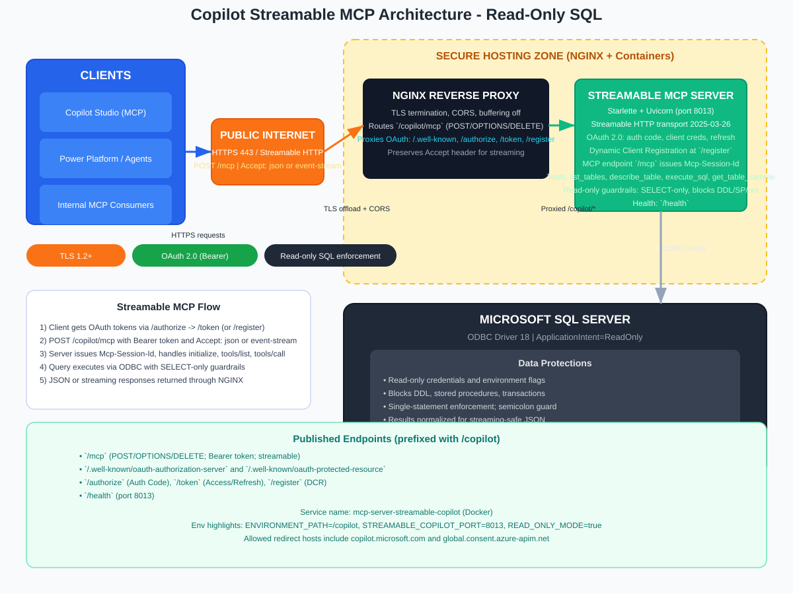

# Copilot Streamable MCP Server (OAuth)

This repository now centers on the **streamable MCP server for Microsoft Copilot**. It exposes a read-only SQL toolset over the MCP 2025-03-26 streamable HTTP transport with OAuth 2.0. The service sits behind Nginx at `https://data.forensic-bot.com/copilot` and is intended for Copilot Studio MCP connections (not custom connectors).

## Architecture



- Nginx terminates TLS and proxies `/copilot/*` to the streamable MCP container.
- OAuth 2.0 discovery, auth, token, and dynamic client registration are built in.
- MCP endpoint `/mcp` serves the SQL tools with read-only guardrails.

## Endpoints

Base: `https://data.forensic-bot.com/copilot`

- MCP (POST/OPTIONS/DELETE; GET returns 405): `/mcp`
- OAuth discovery: `/.well-known/oauth-authorization-server`, `/.well-known/oauth-protected-resource`
- OAuth flows: `/authorize`, `/token`, `/register` (dynamic client registration)
- Health: `/health`

Notes
- Clients must POST to `/mcp`; GET is rejected intentionally.
- Accept should include `application/json`; `text/event-stream` is accepted but responses are JSON-only (no SSE streaming today).

## OAuth 2.0

- Grant: Authorization Code (primary) or Client Credentials for smoke tests. Refresh tokens are issued but the refresh grant is not implemented; request a new token if needed.
- Dynamic Client Registration: POST `/register` returns `client_id` and `client_secret`.
- Redirect hosts must be whitelisted via `ALLOWED_REDIRECT_HOSTS` (docker-compose adds `global.consent.azure-apim.net`).
- Authorization/token/registration respect the `X-Environment-Path` forwarded by Nginx (default `/copilot`).

## MCP Tools

The server exposes four read-only tools:
- `list_tables`: list tables from MSSQL
- `describe_table`: column metadata
- `execute_sql`: SELECT/WITH/SHOW/DESCRIBE/EXPLAIN with guardrails
- `get_table_sample`: sample rows (default 5, max 1000)

## Safety & Behavior

- Read-only enforcement: blocks INSERT/UPDATE/DELETE/MERGE/DDL/transactions/stored procedures; single statement only.
- Table/query validation blocks unsafe inputs and multi-statement payloads.
- Responses are JSON; no SSE payloads are streamed.

## Configuration (env vars)

| Variable | Purpose | Default |
| --- | --- | --- |
| `STREAMABLE_COPILOT_PORT` | Container listen port | `8013` |
| `ENVIRONMENT_PATH` | Path prefix returned in discovery | `/copilot` |
| `SERVER_NAME` | MCP server display name | `Copilot Streamable SQL` |
| `ALLOWED_REDIRECT_HOSTS` | Allowed redirect hosts | `copilot.microsoft.com,powerva.microsoft.com,agents.microsoft.com,microsoft.com,openai.com,chatgpt.com,claude.ai,anthropic.com` (compose adds `global.consent.azure-apim.net`) |
| `READ_ONLY_MODE` | Enforce read-only SQL guardrails | `true` |
| `ALLOWED_OPERATIONS` | Allowed SQL verbs | `SELECT` |
| `BLOCK_DDL` / `BLOCK_STORED_PROCEDURES` / `BLOCK_TRANSACTIONS` | Guardrail toggles | `true` |
| `MSSQL_*`, `TrustServerCertificate`, `Trusted_Connection` | DB connectivity | _(required)_ |

## Deployment

- Service name: `mcp-server-streamable-copilot` in `docker-compose.yml`
- Built from `Dockerfile.copilot_mcp`; exposed on port `8013`; health check hits `/health`.
- Attached to `mcp-network`; shares MSSQL env with other services.

### Local run (compose)

```bash
docker compose build mcp-server-streamable-copilot
docker compose up -d mcp-server-streamable-copilot
docker compose logs -f mcp-server-streamable-copilot
```

For local testing, use `http://localhost:8013` with the same paths and headers.

### Nginx routing (summary)

- `/copilot/mcp` → `mcp-server-streamable-copilot:8013` (POST/OPTIONS/DELETE; Accept forwarded, buffering off)
- OAuth endpoints proxied with `X-Environment-Path: /copilot`
- CORS allows `Authorization, Content-Type, Accept, Mcp-Session-Id`

## Copilot Studio setup (Manual OAuth)

1. Server URL: `https://data.forensic-bot.com/copilot/mcp`
2. Auth: OAuth 2.0 → Manual
3. Fill values:
   - Authorization URL: `https://data.forensic-bot.com/copilot/authorize`
   - Token URL: `https://data.forensic-bot.com/copilot/token`
   - Refresh URL: `https://data.forensic-bot.com/copilot/token`
   - Scopes: blank or `mcp:read`
   - Client ID / secret: see "Getting OAuth Credentials" below
4. Complete consent at the provided redirect URL (host must be allowed).
5. Test connection: Copilot should list tools on `initialize`/`tools/list`.

### Getting OAuth Credentials

There are two ways to obtain `client_id` and `client_secret`:

**Option 1: Dynamic Client Registration (Recommended)**

First, get your redirect URI from Copilot Studio during the connection setup:

1. In Copilot Studio, navigate to where you add connections or actions (location varies by version):
   - Try **Settings** → **Connections** or **Integrations**
   - Or look for **Actions** → **Add an action** → **MCP Server**
   - Or under **Knowledge** → **Add knowledge** → **MCP Server**
2. When configuring the MCP Server connection:
   - Enter Server URL: `https://data.forensic-bot.com/copilot/mcp`
   - Select **OAuth 2.0** authentication
   - Choose **Manual** configuration
3. Copilot Studio will display a **Redirect URI** field (e.g., `https://global.consent.azure-apim.net/redirect/abcd1234-5678-90ef-ghij`)
4. **Copy this redirect URI** - you'll need it for the next step

Then register a new OAuth client using the `/register` endpoint with your actual redirect URI:

```bash
curl -X POST https://data.forensic-bot.com/copilot/register \
  -H "Content-Type: application/json" \
  -d '{
    "client_name": "My Copilot MCP",
    "redirect_uris": ["https://global.consent.azure-apim.net/redirect/abcd1234-5678-90ef-ghij"]
  }'
```

Note: Replace `abcd1234-5678-90ef-ghij` with your actual connection ID from the redirect URI shown in Copilot Studio.

**Alternative**: If you can't find the redirect URI yet, you can register with a placeholder first and update it later, or use the test credentials below to get started quickly.

Response:
```json
{
  "client_id": "client_a1b2c3d4e5f6g7h8",
  "client_secret": "some-long-secure-secret-string",
  "client_id_issued_at": 1737849600,
  "grant_types": ["authorization_code", "refresh_token"],
  "redirect_uris": ["https://global.consent.azure-apim.net/redirect/your-connection-id"],
  "client_name": "My Copilot MCP",
  "server_mode": "read_only"
}
```

**Save both** `client_id` and `client_secret` from the response and use them in Copilot Studio's OAuth configuration.

**Option 2: Test Credentials (Testing Only)**

For quick testing, use these credentials:
- Client ID: `test`
- Client Secret: `test`

⚠️ **Warning**: Test credentials are for development only and should not be used in production. The server does not validate client credentials during token issuance, but dynamically registered clients are recommended for proper tracking and security.

## Smoke tests (curl)

```bash
# Health
curl https://data.forensic-bot.com/copilot/health

# Client credentials token (testing only)
TOKEN=$(curl -s -X POST https://data.forensic-bot.com/copilot/token \
  -H "Content-Type: application/json" \
  -d '{"grant_type":"client_credentials","client_id":"test","client_secret":"test"}' | jq -r .access_token)

# Initialize
curl -X POST https://data.forensic-bot.com/copilot/mcp \
  -H "Authorization: Bearer $TOKEN" \
  -H "Accept: application/json" \
  -H "Content-Type: application/json" \
  -d '{"id":1,"jsonrpc":"2.0","method":"initialize"}'

# List tools
curl -X POST https://data.forensic-bot.com/copilot/mcp \
  -H "Authorization: Bearer $TOKEN" \
  -H "Accept: application/json" \
  -H "Content-Type: application/json" \
  -d '{"id":2,"jsonrpc":"2.0","method":"tools/list"}'
```

## Troubleshooting

- `401` on `/mcp`: token missing/expired; fetch a token from `/copilot/token`.
- `405` on `/mcp`: GET is rejected; use POST.
- OAuth 400 untrusted redirect: add the host to `ALLOWED_REDIRECT_HOSTS` and restart.
- Copilot “server URL missing”: ensure the Server URL is `https://data.forensic-bot.com/copilot/mcp` and avoid stale duplicate connections in Copilot Studio.
