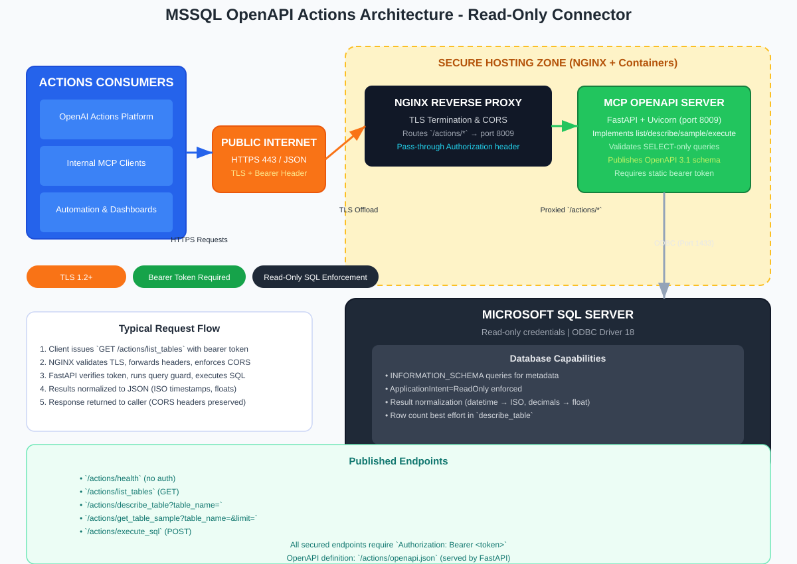

# Servicio OpenAPI para Copilot

Este repositorio aloja el contenedor OpenAPI para Microsoft Copilot / Power Platform que expone una superficie SQL **solo lectura** vía Swagger 2.0 (OpenAPI 2.0) con autenticación por API key. Comparte el front Nginx y el Docker Compose con el resto de servicios del repo y está pensado para importarse como custom connector en Copilot Studio.

## Arquitectura



- Nginx termina TLS y enruta `/copilot/actions/*` hacia el contenedor.
- El contenedor sirve un Swagger 2.0 fijo y cuatro acciones read-only respaldadas por MSSQL.
- La API key se valida en el edge y en el servicio.

## Endpoints

Base pública: `https://data.forensic-bot.com/copilot/actions/`

- `GET /health` (sin auth)
- `GET /list_tables`
- `GET /describe_table?table_name=...`
- `POST /execute_sql` (body: `{ "query": "SELECT ..." }`)
- `GET /get_table_sample?table_name=...&limit=...`
- Swagger: `/swagger.json`

Cada operación publica un `operationId` estable (`list_tables`, `describe_table`, `execute_sql`, `get_table_sample`).

## Autenticación

- Esquema: API key
- Header: por defecto `x-api-key` (override con `COPILOT_API_KEY_HEADER`)
- Valor: `COPILOT_API_KEY`
- Claves faltantes o inválidas devuelven `401`.

## Comportamiento y Guardas de Seguridad

- Solo lectura: se rechaza INSERT/UPDATE/DELETE/MERGE/DDL/transactions/stored procedures.
- Se permite un único SELECT/WITH por request.
- Las filas se serializan como strings para evitar errores en PowerFx (null → string vacía, datetime → ISO 8601, bytes → hex).
- Límite de `get_table_sample`: 1–1000 filas.

## Configuración

Variables de entorno (ver `docker-compose.yml`):

| Variable | Propósito | Default |
| --- | --- | --- |
| `COPILOT_API_KEY` | Valor de API key esperado en el header | _(requerido)_ |
| `COPILOT_API_KEY_HEADER` | Nombre del header a inspeccionar | `x-api-key` |
| `OPENAPI_COPILOT_SERVER_URL` | URL publicada en el Swagger | `https://data.forensic-bot.com/copilot/actions` |
| `OPENAPI_COPILOT_PORT` | Puerto de escucha del contenedor | `8012` |
| `MSSQL_HOST`, `MSSQL_USER`, `MSSQL_PASSWORD`, `MSSQL_DATABASE`, `MSSQL_DRIVER`, `TrustServerCertificate`, `Trusted_Connection`, `READ_ONLY_MODE` | Configuración compartida de base de datos | _(requerido)_ |

## Despliegue

El servicio se define como `mcp-server-openapi-copilot` en `docker-compose.yml`, se construye con `Dockerfile.openapi_copilot`, expone el puerto `8012` y se une a `mcp-network`. El health check apunta a `/health`.

### Ejecución local (compose)

```bash
docker compose build mcp-server-openapi-copilot
docker compose up -d mcp-server-openapi-copilot
docker compose logs -f mcp-server-openapi-copilot
```

Para pruebas locales usa `http://localhost:8012/` con los mismos paths y headers.

### Routing en Nginx

- El front se comparte con los demás servicios; la ruta está en `nginx/conf.d/default.conf`.
- Proxy de `/copilot/actions/` hacia el contenedor y reenvía el header de API key.
- CORS permite `GET, POST, OPTIONS` más el header configurado, `Content-Type` y `Accept`.

## Pruebas (curl)

```bash
# Health (sin auth)
curl https://data.forensic-bot.com/copilot/actions/health

# Listar tablas
curl -H "x-api-key: $COPILOT_API_KEY" \
  https://data.forensic-bot.com/copilot/actions/list_tables

# Ejecutar SQL
curl -H "x-api-key: $COPILOT_API_KEY" -H "Content-Type: application/json" \
  -d '{"query":"SELECT TOP 3 * FROM dbo.YourTable"}' \
  https://data.forensic-bot.com/copilot/actions/execute_sql
```

## Importar en Copilot Studio / Power Platform

1. Verifica que el servicio esté disponible en `https://data.forensic-bot.com/copilot/actions/swagger.json`.
2. En el wizard de custom connector, importa la definición Swagger 2.0 desde esa URL.
3. Configura el parámetro de API key con el header que uses (por defecto `x-api-key`) y el valor de `COPILOT_API_KEY`.
4. Prueba cada acción: `list_tables`, `describe_table`, `execute_sql`, `get_table_sample`.
