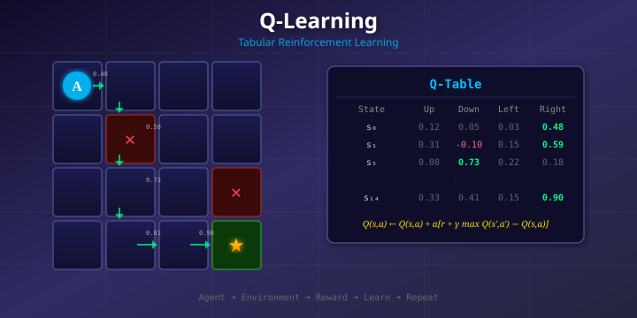
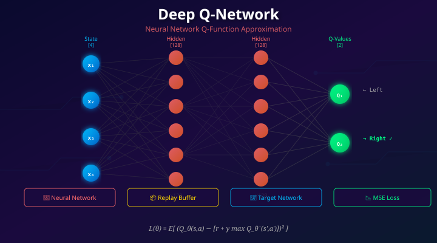

# RL Q-Learning — Parte 3: Métodos Avanzados Basados en Valor

<p align="center">
  
  
</p>

**Parte 3** de la serie Q-Learning. Este documento cubre los cuatro métodos avanzados — C51, QR-DQN, Rainbow DQN y HER — su motivación, cómo funcionan y cómo ejecutarlos desde este repositorio.

> **Navegación de la serie**
> - **Parte 1**: Fundamentos de Q-Learning + DQN básico → [README.md](README.md) · [README_es.md](README_es.md)
> - **Parte 2**: Extensiones de DQN (Double, Dueling, Noisy, PER, N-step) → [README_part2.md](README_part2.md) · [README_part2_es.md](README_part2_es.md)
> - **Parte 3** (este archivo): Variantes avanzadas (C51, QR-DQN, Rainbow, HER)

---

## ¿Por qué ir más allá de las extensiones de la Parte 2?

La Parte 2 corrigió cinco debilidades específicas de DQN vanilla, pero todas siguen prediciendo un **único escalar** Q(s,a) por acción. La Parte 3 se pregunta: ¿y si ese escalar no es suficiente?

| Limitación | Qué aporta la Parte 3 |
|------------|----------------------|
| **Los valores Q escalares pierden la forma del retorno** — la media oculta varianza, bimodalidad y riesgos de cola | C51 y QR-DQN aprenden la **distribución completa** de retornos, no solo su media |
| **Las extensiones individuales no se combinan automáticamente** — integrarlas requiere cuidado | Rainbow DQN integra las seis mejoras ortogonales en un solo agente |
| **Las recompensas escasas vacían el replay buffer** — casi todos los episodios producen reward = 0 | HER reetiqueta trayectorias fallidas con metas que el agente sí alcanzó, generando señal de entrenamiento útil |

El insight clave de C51 y QR-DQN: **la selección de acción no cambia** — se sigue eligiendo `argmax` sobre los valores esperados. Lo que cambia es *cómo se entrena la red*. Un target distribucional provee 51 señales de gradiente por actualización en lugar de 1, lo que permite un aprendizaje más rápido y estable.

---

## Prerrequisitos

Esta parte asume familiaridad con los siguientes conceptos de las Partes 1 y 2:

| Concepto | Resumen en una oración |
|----------|----------------------|
| Target de Bellman | `y = r + γ · bootstrap` es el objetivo TD fundamental |
| Bucle DQN | replay buffer + target network + online Q-network |
| Double DQN | la online net selecciona la mejor acción, la target net la evalúa |
| Dueling DQN | `Q = V + A − mean(A)` separa el valor del estado de la ventaja de la acción |
| Noisy DQN | ruido paramétrico aprendido reemplaza epsilon-greedy |
| PER | muestreo ponderado por error TD; corregido con pesos de importance-sampling |
| N-step DQN | bootstrap desde n pasos adelante: `G_t^(n) = r_t + γ·r_{t+1} + ... + γⁿ Q(s_{t+n}, ·)` |

Transición rápida de Parte 2 a Parte 3:
- Parte 2 mejoró **la optimización y el uso de datos** para valores Q escalares.
- Parte 3 mejora **la representación del target** (RL distribucional) y **el reetiquetado de objetivos** (HER).

---

## Instalación

```bash
uv sync
```

---

## Método 1 — C51 (DQN Categórico)

### Qué mejora
DQN vanilla aprende `Q(s,a) = E[G_t | s,a]` — el retorno *esperado*. La media puede ocultar información crucial sobre la forma de los resultados.

Considera dos acciones con el mismo valor esperado de 50:
- **Acción A**: devuelve exactamente 50 en todos los casos — segura y predecible.
- **Acción B**: devuelve 0 en el 95% de los casos pero 1000 en el 5% — alto riesgo, cola pesada.

Un DQN escalar no puede distinguirlas. C51 sí puede, porque aprende la distribución de probabilidad completa sobre los retornos, dándole a la red una señal de entrenamiento mucho más rica.

### Cómo funciona
C51 discretiza el rango de retornos `[V_min, V_max]` en `N=51` **átomos** equiespaciados:

```
z_i = V_min + i · Δz,   i = 0..50,   Δz = (V_max − V_min) / 50
```

La red produce **logits** por acción y por átomo, convertidos a probabilidades mediante softmax:

```
p_i(s,a) = softmax(logits_i)   →   P(Z(s,a) = z_i)
```

La selección de acción usa el valor esperado — idéntico a DQN vanilla:

```
Q(s,a) = Σ_i p_i(s,a) · z_i       argmax sobre esto da la acción greedy
```

El entrenamiento usa **proyección categórica + entropía cruzada**. Para cada átomo `z_i` de la distribución target:
1. **Desplazar**: `Tz_i = r + γ · z_i`
2. **Recortar**: `Tz_i = clip(Tz_i, V_min, V_max)`
3. **Proyectar**: dividir la masa entre los dos átomos vecinos más cercanos por interpolación lineal

Pérdida:

```
L = −Σ_i target_prob_i · log(predicted_prob_i)
```

Esta es una señal de supervisión de 51 dimensiones en lugar de un escalar — la red aprende *en qué se equivocó* a lo largo de toda la distribución de retornos en cada paso.

### Cambios en el código — `benchmarks/dqn_c51.py`

```python
class C51Network(nn.Module):
    def forward(self, x):
        logits = self.net(x)
        return logits.view(-1, self.n_actions, self.n_atoms)   # [batch, acciones, 51]

def _q_values_from_logits(logits, supports):
    probs = torch.softmax(logits, dim=-1)
    return torch.sum(probs * supports.view(1, 1, -1), dim=-1)  # E[Z] = Q

def _project_distribution(next_probs, rewards, dones, gamma, supports, v_min, v_max):
    # Desplazar → recortar → interpolación lineal a vecinos
    ...

# Pérdida de entrenamiento
pred_log_probs = F.log_softmax(pred_logits[range(batch), b_a_t], dim=-1)
loss = -(target_dist * pred_log_probs).sum(dim=-1).mean()
```

Nuevos hiperparámetros:

| Parámetro | Valor por defecto | Notas |
|-----------|-------------------|-------|
| `v_min` | 0 | Retorno mínimo del soporte |
| `v_max` | 500 | Retorno máximo del soporte |
| `n_atoms` | 51 | Número de átomos categóricos |

### Ejecutarlo

```bash
uv run python dqn_c51_benchmark.py --record-video --plot
```

### Cuándo ayuda más
- Entornos con distribuciones de retorno bimodales o de cola pesada
- Cuando la señal de entrenamiento más rica se traduce en convergencia más rápida
- Como mejora distribucional directa sobre DQN vanilla

### Consejos de ajuste

| Síntoma | Causa probable | Acción |
|---------|----------------|--------|
| Curva plana temprana | rango `V_min/V_max` estrecho | ampliar el soporte |
| Pérdida inestable | tasa de aprendizaje alta | reducir `learning_rate` |
| Política sin discriminar | colapso de masa en un átomo | revisar escala de logits |
| Buen entrenamiento, mala evaluación | sobreajuste a la distribución del replay | aumentar cadencia de evaluación, usar varias semillas |

---

## Método 2 — QR-DQN (DQN con Regresión Cuantílica)

### Qué mejora
C51 fija las *posiciones* de los átomos y aprende las *probabilidades*. QR-DQN invierte esto: fija *probabilidades* iguales y aprende las *posiciones* (valores cuantílicos). La principal ventaja práctica: **no se necesita `V_min`/`V_max`** — la red determina el rango del soporte automáticamente.

### Cómo funciona
QR-DQN predice `N=51` valores cuantílicos por acción. Cada uno lleva igual masa de probabilidad `1/N`. Las fracciones cuantílicas se fijan en los puntos medios:

```
τ_i = (i + 0.5) / N
```

Así `τ_0 ≈ 0.01` es el percentil 1, `τ_25 ≈ 0.50` es la mediana, `τ_50 ≈ 0.99` es el percentil 99.

La selección de acción es la media aritmética de los cuantiles:

```
Q(s,a) = (1/N) · Σ_i θ_i(s,a)
```

El entrenamiento usa la **pérdida Huber cuantílica asimétrica**. Para cada error TD por pares `δ_ij = target_j − pred_i`:

```
ρ_τ(δ) = |τ − I[δ < 0]| · Huber_κ(δ)
```

Si el cuantil `τ=0.9` subestima (δ>0), el peso = `|0.9−0| = 0.9` (fuerte). Si sobreestima (δ<0), el peso = `|0.9−1| = 0.1` (débil). Esta asimetría empuja al percentil 90 a estar por encima del 90% de los valores target — exactamente la definición de cuantil.

### Cambios en el código — `benchmarks/dqn_qr.py`

```python
class QRDQN(nn.Module):
    def forward(self, x):
        quantiles = self.net(x)
        return quantiles.view(-1, self.n_actions, self.n_quantiles)  # [batch, acciones, 51]

def _q_values_from_quantiles(quantiles):
    return quantiles.mean(dim=-1)   # media simple — cada cuantil tiene igual peso 1/N

def _quantile_huber_loss(pred_quantiles, target_quantiles, taus, kappa):
    td = target_quantiles.unsqueeze(1) - pred_quantiles.unsqueeze(2)  # [batch, N, N]
    huber = torch.where(torch.abs(td) <= kappa,
                        0.5 * td.pow(2),
                        kappa * (torch.abs(td) - 0.5 * kappa))
    quantile_weight = torch.abs(taus.view(1, -1, 1) - (td.detach() < 0).float())
    return (quantile_weight * huber).mean()
```

### Ejecutarlo

```bash
uv run python dqn_qr_benchmark.py --record-video --plot
```

### C51 vs QR-DQN de un vistazo

| Aspecto | C51 | QR-DQN |
|---------|-----|--------|
| Posiciones del soporte | Fijas en `[V_min, V_max]` | Aprendidas (libres de moverse) |
| Masa de probabilidad | Aprendida vía softmax | Uniforme fija `1/N` |
| Sensibilidad principal | Clipping por rango del soporte | Estabilidad de la pérdida cuantílica |
| Tipo de pérdida | Entropía cruzada sobre distribución proyectada | Huber cuantílica asimétrica |
| Ventaja clave | Baseline estable y simple | No requiere rango de soporte |

### Consejos de ajuste

| Síntoma | Causa probable | Acción |
|---------|----------------|--------|
| Alta varianza entre runs | Pocos cuantiles | Aumentar `num_quantiles` |
| Convergencia lenta | LR/batch conservadores | Ajustar batch size o LR |
| Picos en la pérdida | Inestabilidad en pares TD | Bajar LR, usar clipping de gradiente |
| Mejora pequeña vs C51 | Entorno demasiado simple | Esperado en tareas de control sencillas |

---

## Método 3 — Rainbow DQN

### Qué es
Rainbow no es un algoritmo nuevo — es la respuesta a: *"¿Qué pasa si combinamos las seis mejoras ortogonales de DQN en un solo agente?"*

Cada componente ataca un modo de fallo distinto:

| Componente | Qué corrige | Dónde vive |
|-----------|-------------|------------|
| Double DQN | Sesgo de sobreestimación por el operador `max` | Selección de acción target en el bucle de entrenamiento |
| Arquitectura Dueling | No puede separar valor del estado de ventaja de la acción | `RainbowDQN.forward()` streams valor/ventaja |
| Capas ruidosas | Exploración epsilon-greedy burda | `NoisyLinear` reemplaza `nn.Linear` |
| Replay priorizado | Muestreo uniforme pierde tiempo en transiciones fáciles | `PrioritizedReplayBuffer` |
| Retornos N-step | Propagación lenta de recompensa | `nstep_buffer` en el bucle de entrenamiento |
| Distribución C51 | Target escalar descarta la forma del retorno | Cabezal distribucional + `_project_distribution` |

Como corrigen *problemas diferentes*, sus ganancias se acumulan. El paper original de Rainbow (Hessel et al., 2018) mostró que eliminar cualquier componente individual empeora el rendimiento, confirmando que los seis contribuyen.

### Cómo funciona — la red

Rainbow combina dueling, distribucional y ruidoso en un solo forward pass:

```python
class RainbowDQN(nn.Module):
    def forward(self, x):
        f = self.feature(x)                                      # extractor de features compartido
        adv = self.adv2(F.relu(self.adv1(f)))                    # stream de ventaja ruidoso
        val = self.val2(F.relu(self.val1(f)))                    # stream de valor ruidoso
        adv = adv.view(-1, self.n_actions, self.n_atoms)
        val = val.view(-1, 1, self.n_atoms)
        return val + adv - adv.mean(dim=1, keepdim=True)         # combinación dueling
        # salida: [batch, n_actions, n_atoms]  ← misma forma que C51
```

### Cómo funciona — el bucle de entrenamiento

La señal de entrenamiento distintiva de Rainbow es una **pérdida mixta** que combina targets distribucionales de 1-step y n-step:

```python
# 1. Sin epsilon: la red ruidosa proporciona exploración automática
action = _q_values_from_logits(policy_net(state_t), supports).argmax(dim=1).item()

# 2. Almacenar 8-tupla: ambos targets 1-step y n-step de la misma transición
memory.add((s, a, r_1, ns_1, d_1, r_n, ns_n, d_n))

# 3. Pérdida mixta: 1-step (estable) + n-step (propagación rápida)
loss_1 = -(target_dist_1step * pred_log_probs).sum(-1)
loss_n = -(target_dist_nstep * pred_log_probs).sum(-1)
per_sample_loss = cfg.one_step_loss_coef * loss_1 + cfg.n_step_loss_coef * loss_n

# 4. Ponderado por IS de PER, luego backprop
loss = (is_weights_t * per_sample_loss).mean()
loss.backward()
torch.nn.utils.clip_grad_norm_(policy_net.parameters(), cfg.grad_clip_norm)

# 5. Actualizar prioridades con pérdida combinada
memory.update_priorities(indices, per_sample_loss.detach().cpu().numpy() + 1e-6)
```

### Ejecutarlo

```bash
uv run python dqn_rainbow_benchmark.py --record-video --plot
```

### Playbook de ajuste — fase a fase

Ajustar por etapas, no todo a la vez:

1. **Empezar con valores por defecto** — verificar que la curva de aprendizaje no diverge
2. **Ajustar PER** (`alpha`, `beta`) solo cuando la curva base ya sea saludable
3. **Ajustar n-step** horizonte y coeficientes de pérdida
4. **Finalmente refinar** el rango distribucional (`v_min`, `v_max`) y parámetros ruidosos (`sigma_init`)

```bash
uv run python dqn_rainbow_benchmark.py --device cuda \
    --grad-clip-norm 10 --one-step-loss-coef 1.0 --n-step-loss-coef 1.0
```

### Checklist de depuración

| Síntoma | Causa probable | Acción |
|---------|----------------|--------|
| Divergencia tardía | Mezcla de pérdidas agresiva o LR alto | Bajar LR y coeficiente n-step |
| Aprendizaje lento con PER | Prioridades saturadas (todas iguales) | Revisar llamadas a `update_priorities()` |
| Alta sensibilidad a la semilla | Exploración ruidosa excesiva | Reducir `sigma_init` o ampliar warm-up |
| Ejecución lenta en CPU | Configuración pesada | Usar `--device cuda` si está disponible |

---

## Método 4 — HER (Hindsight Experience Replay)

### Qué corrige
En tareas de objetivo escaso, la recompensa es casi siempre cero. Un replay buffer lleno de episodios fallidos prácticamente no proporciona señal de supervisión.

**Ejemplo concreto**: un robot debe colocar un objeto en un punto preciso. Por exploración aleatoria casi nunca lo logra, por lo que miles de transiciones del replay tienen reward = 0. El agente no aprende nada.

El insight de HER: *"No llegaste al objetivo que querías — pero ¿adónde sí llegaste?"*

### Cómo funciona
Después de cada episodio, HER **reetiqueta** transiciones del objetivo original (fallido) a objetivos que el agente *realmente alcanzó*:

```
Transición original:   (s=3, a=derecha, r=0, s'=4, g=7)   ← fracaso
Reetiquetada:          (s=3, a=derecha, r=1, s'=4, g'=4)  ← éxito!
```

La trayectoria física no cambia. Solo se intercambia la etiqueta del objetivo. Lo que era un fracaso total ahora contribuye una señal de supervisión exitosa.

**Ejemplo paso a paso** (agente intenta llegar a posición 7, termina en 4):

Transiciones originales (todas reward = 0):
```
(s=0, a=derecha, r=0, s'=1, g=7)
(s=1, a=derecha, r=0, s'=2, g=7)
(s=2, a=derecha, r=0, s'=3, g=7)
(s=3, a=derecha, r=0, s'=4, g=7)
```

Transiciones reetiquetadas (HER pretende que la meta era 4):
```
(s=0, a=derecha, r=0, s'=1, g'=4)
(s=1, a=derecha, r=0, s'=2, g'=4)
(s=2, a=derecha, r=0, s'=3, g'=4)
(s=3, a=derecha, r=1, s'=4, g'=4)  ← éxito!
```

### Multiplicación de datos
Un episodio de 10 pasos con `her_k=4` genera hasta 40 transiciones reetiquetadas adicionales a las 10 originales — ~50 actualizaciones totales de un episodio que habría sido casi inútil sin HER.

### Cambios en el código — `benchmarks/her.py`

```python
# Q-table condicionada por objetivo: Q[posición, objetivo, acción]
q_table = np.zeros((grid_size, grid_size, 2), dtype=np.float32)

# Update de Bellman estándar — la matemática no cambia, el objetivo es una dimensión extra
def _td_update(q_table, state, action, reward, next_state, done, alpha, gamma):
    current_q = q_table[state[0], state[1], action]
    next_best = 0.0 if done else float(np.max(q_table[next_state[0], next_state[1]]))
    target = reward + gamma * next_best
    q_table[state[0], state[1], action] = (1 - alpha) * current_q + alpha * target

# Bucle de reetiquetado HER — después de cada episodio
for t in range(len(trajectory)):
    s_t, a_t, _, ns_t, _, _ = trajectory[t]
    future_indices = range(t, len(trajectory))
    sampled = random.sample(list(future_indices), k=min(cfg.her_k, len(trajectory) - t))
    for idx in sampled:
        future_goal = trajectory[idx][5]               # objetivo alcanzado en paso futuro
        her_state = (s_t[0], future_goal)
        her_next_state = (ns_t[0], future_goal)
        her_done = her_next_state[0] == future_goal
        her_reward = 0.0 if her_done else -1.0
        _td_update(q_table, her_state, a_t, her_reward,
                   her_next_state, her_done, cfg.learning_rate, cfg.gamma)
```

> **Insight clave**: HER cambia la **distribución de datos**, no la matemática de Bellman. La Q-function pasa a ser `Q(s, g, a)` — condicionada por objetivo. La regla de actualización es idéntica al Q-learning vanilla. Lo que cambia es qué transiciones se le pasan como entrada.

### Ejecutarlo

```bash
uv run python her_benchmark.py --plot
```

### Cuándo ayuda más
- Funciones de recompensa binarias o muy escasas donde la exploración aleatoria rara vez tiene éxito
- Tareas condicionadas por objetivo donde el agente puede alcanzar objetivos cercanos aunque falle el target real
- Cualquier escenario donde el replay buffer está abrumadoramente lleno de transiciones con reward = 0

### Consejos de ajuste

| Síntoma | Causa probable | Acción |
|---------|----------------|--------|
| HER no mejora | `her_k` muy bajo | Aumentar `her_k` (probar 8) |
| Métricas irreales | Bug en recomputación de recompensa | Verificar que `her_done` corresponde al objetivo reetiquetado |
| Sobreajuste a metas reetiquetadas | Demasiadas muestras hindsight | Rebalancear transiciones originales vs HER |
| Tarea sigue fallando | Exploración insuficiente | Combinar HER con mejor política de exploración |
| Q-table demasiado grande | `grid_size` excesivo | Reducir grid o cambiar a DQN + HER |

---

## Ejecutar todos los métodos de la Parte 3 juntos

Comparar los cuatro métodos contra DQN vanilla en una sola ejecución:

```bash
uv run python run_all_comparison.py \
  --methods dqn dqn_c51 dqn_qr dqn_rainbow her
```

Ejecutar cada método individualmente con video y gráficas:

```bash
uv run python dqn_c51_benchmark.py      --record-video --plot
uv run python dqn_qr_benchmark.py       --record-video --plot
uv run python dqn_rainbow_benchmark.py  --record-video --plot
uv run python her_benchmark.py          --plot
```

Generar reportes agregados después de ejecutar:

```bash
uv run python scripts/aggregate_results.py \
    --inputs outputs/*.json \
    --output-json outputs/aggregate_summary.json \
    --output-csv  outputs/aggregate_summary.csv

uv run python scripts/generate_aggregate_report.py \
    --input outputs/aggregate_summary.json \
    --output-dir outputs/report \
    --title "RL Advanced Part 3 Aggregate"
```

---

## Resumen de métodos

| Método | Qué cambia | Nuevos hiperparámetros | Coste | Mejor para |
|--------|-----------|------------------------|-------|-----------|
| **C51** | Salida = 51 átomos por acción + pérdida de proyección categórica | `v_min`, `v_max`, `n_atoms` | Moderado | Baseline distribucional estable |
| **QR-DQN** | Salida = 51 valores cuantílicos por acción + Huber asimétrico | `num_quantiles`, `kappa` | Moderado | Soporte flexible, no requiere rango |
| **Rainbow** | Los 6 componentes combinados: ruidoso + dueling + distribucional + PER + n-step + double | Varios (ver playbook) | Alto | Agente basado en valor fuerte por defecto |
| **HER** | Q condicionada por objetivo + bucle de reetiquetado tras cada episodio | `her_k` | Bajo | Tareas de objetivo escaso |

Mensajes clave:
- C51 y QR-DQN aprenden **distribuciones de retorno**, pero las parametrizan de forma opuesta.
- Rainbow apila todas las mejoras ortogonales — las ganancias se multiplican porque corrigen problemas distintos.
- HER mejora la **eficiencia de datos** reutilizando episodios fallidos; es complementario a todas las variantes de DQN.
- **Double DQN** (de la Parte 2) se reutiliza dentro de Rainbow — mejora estricta y gratuita, siempre incluirlo.

---

## Artefactos de salida

| Ruta | Contenido |
|------|-----------|
| `outputs/comparison_results.json/csv` | Métricas por corrida para todos los métodos |
| `outputs/aggregate_summary.json/csv` | Estadísticas agregadas multi-corrida |
| `outputs/report/` | Gráficos y reportes HTML generados |
| `videos/` | Episodios de evaluación grabados |
| `runs/` | Datos de TensorBoard |

---

## Documentación

- Guía de presentación (inglés): [doc/presentations/presentation_guide_part3_60min.md](doc/presentations/presentation_guide_part3_60min.md)
- Guía de presentación (español): [doc/presentations/presentation_guide_part3_60min_es.md](doc/presentations/presentation_guide_part3_60min_es.md)
- Documentación de algoritmos (inglés): [doc/README.md](doc/README.md)
- Documentación de algoritmos (español): [doc/es/README.md](doc/es/README.md)
- Parte 2 (extensiones DQN): [README_part2_es.md](README_part2_es.md)
- Parte 1 (Q-Learning + DQN): [README_es.md](README_es.md)
